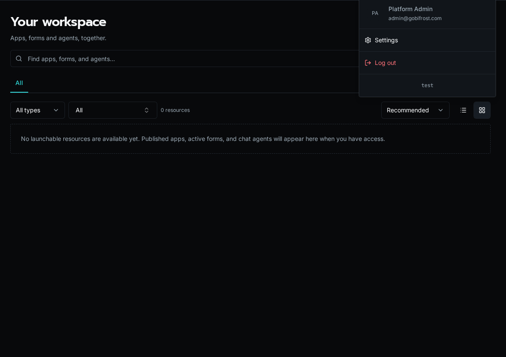

import { Aside } from '@astrojs/starlight/components';

Bifrost ships as three coordinated artifacts — the **API server**, the **bifrost CLI**, and the **web client** — and they need to stay roughly in step. This page documents how versions are surfaced and how the CLI guards against running against an API it doesn't understand.

## Release channels

| Channel | Tag or image | Intended use |
|---|---|---|
| Development | `:dev` | Bleeding-edge builds from `main`. Expect bugs; the maintainer runs this channel first to find them before a release. |
| Release candidate | `vX.Y.Z-rc.N` | Signed, versioned builds for operators who want changes sooner without tracking every development build. Candidates do not update `:latest`. |
| Full release | `vX.Y.Z` and `:latest` | The stable production channel. Full releases are planned roughly monthly, with release candidates between them. |

Pin an exact version in production when you control rollout timing. Use `:latest` when you want each final release, and use `:dev` only when you accept continuous change.

## Where the version lives

### API server (`BIFROST_VERSION` env var)

The API container is built with a `BIFROST_VERSION` environment variable (for example, `1.3.0`). At runtime, the API returns it from `GET /api/version`:

```bash
curl https://your-bifrost.example.com/api/version
```

```json
{
  "version": "1.3.0",
  "min_cli_version": "1.2.3"
}
```

If `BIFROST_VERSION` isn't set (typical for local development), the API falls back to `git describe --tags --always --dirty` from the repo working tree. If neither is available the version reports as `unknown`.

### CLI (`--version` / `-V`)

```bash
bifrost --version
# bifrost 1.3.0
```

The flag short-circuits before any other CLI logic, so it works even when the CLI can't reach an API.

### Web client (sidebar / footer)

The version is printed in the user dropdown in the top-right of the app. Click it to copy the version string to your clipboard — handy when filing bug reports.



The client reads its version from `VITE_BIFROST_VERSION` at build time. If that env var isn't set during the Vite build, the menu displays `unknown`.

## CLI ↔ API compatibility check

Every CLI invocation issues a fast `GET /api/version` against the selected API and compares the response's `min_cli_version` to its installed version. A CLI below that minimum exits before dispatching the command and prints an API-matched upgrade command:

```
Your Bifrost CLI 1.2.2 is below this server's minimum supported version 1.2.3. You must upgrade:
  pipx install --force https://your-bifrost.example.com/api/cli/download/bifrost-cli.tar.gz
```

This minimum-version check is a hard compatibility gate. It prevents an older client from sending a request whose meaning or response contract changed.

Build drift above the minimum remains a soft notice: a compatible CLI may continue when the server is newer. If the server is unreachable or returns an unreadable version document, the CLI prints a warning and continues because it cannot establish incompatibility.

### Upgrading the CLI

```bash
bifrost update
```

Pass `--url` when you need to update from a specific instance:

```bash
bifrost update --url https://your-bifrost.example.com
```

After the upgrade, re-run with `--version` to confirm:

```bash
bifrost --version
# bifrost 1.3.0
```

<Aside type="tip">
The CLI is independent from the SDK package you `import bifrost` from inside workflows. Workflow runtimes use whatever `bifrost` package is installed in the API container — they don't read your local CLI version.
</Aside>

## Pinning versions in production

For self-hosted deployments, pin the **same version tag** across all three artifacts:

- API container: `ghcr.io/gobifrost/bifrost-api:1.3.0` (sets `BIFROST_VERSION=1.3.0`)
- Worker container: same tag as API
- Web client: `ghcr.io/gobifrost/bifrost-client:1.3.0`
- Operator CLI: update from that API with `bifrost update --url https://your-bifrost.example.com`

Mismatched API and worker tags will land you with workflows that compile but fail at runtime when the worker can't find a method the API serialized. Always upgrade them together.

## The `GET /api/version` endpoint

This endpoint is unauthenticated by design — health checks, the CLI compatibility probe, and external monitoring all need to read it without credentials.

| Field | Meaning |
|---|---|
| `version` | Current API version (the value of `BIFROST_VERSION`, or `git describe`, or `unknown`). |
| `min_cli_version` | The lowest CLI version the API accepts. Commands from older released CLIs are blocked until the CLI is updated. |

`min_cli_version` is **a hard-coded constant** in the API source — it's not configurable per deployment. To bump the floor, the platform release ships an API where the constant has been raised; downstream installs pick it up by upgrading the API container.

## Troubleshooting

**`bifrost --version` prints `unknown`.**
You're on a CLI installed from a development checkout where version metadata was not baked in. Reinstall from the selected instance with `bifrost update --url https://your-bifrost.example.com`.

**API reports `version: "unknown"`.**
`BIFROST_VERSION` wasn't set in the container env and the working tree isn't a git checkout (typical for production images). Check your Helm values / Compose file for the missing env var.

**CLI keeps reporting that it is too old after an update.**
Two `bifrost` binaries may be on your `PATH`, with the older one winning. Check `which bifrost`, `bifrost --version`, and your `pipx list` or environment-specific package list.

## See also

- [Installation Guide](/docs/getting-started/installation/) — initial setup of CLI + API
- [Local Development setup](/docs/how-to-guides/local-dev/setup/) — running the dev stack with hot reload
