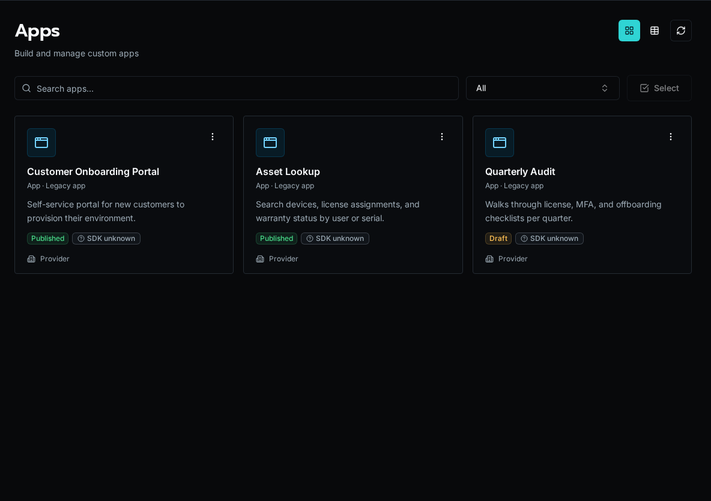

import { Aside } from '@astrojs/starlight/components';

## What is App Builder?

App Builder lets you ship custom web applications backed by Bifrost workflows, tables, and auth. An app is a React + TypeScript project that mounts at `/apps/{slug}` and talks to the platform through the `bifrost` SDK.

There are two App runtimes. **New Apps use V2.** V2 has two ownership models: an independent App repository or a Solution-owned App.

| | **V2** (current default) | **V1** (legacy) |
|---|---|---|
| What it is | A real, self-contained React project | An inline bundle rendered by the platform |
| Rendering | Owns its own `createRoot` + `<BrowserRouter>` | Platform renders your pages inline |
| SDK access | `import … from "bifrost"` (a real npm package) | Everything injected via `globalThis.__bifrost_platform` |
| Where deps come from | Normal `package.json` (Vite, React, shadcn, lucide) | A single `"bifrost"` import + up to 20 esm.sh packages |
| How it ships | Independently with `bifrost app deploy`, or with a **Solution** | `_repo` source with draft and publish |



## V2 React Apps

A V2 App is an ordinary React project. It owns its root and router and imports the Bifrost SDK as a package served by the selected Bifrost instance.

### Choose ownership

| | Independent App | Solution App |
|---|---|---|
| Choose it when | One frontend should have its own repository and deployment lifecycle | The App and its workflows, tables, configs, or other definitions must install and reconcile together |
| Source | Normal repository; no YAML and no `_repo` App source | `apps/<slug>` plus Solution descriptor and manifests |
| Local development | `bifrost app start` against live registered workflows and data | `bifrost solution start` with local Solution workflows and the install's live data |
| Deploy | `bifrost app deploy` changes only the compiled App artifact | `bifrost solution deploy` full-replaces the install's managed definitions |
| Binding | Gitignored `.env` with `BIFROST_API_URL` and `BIFROST_APP_ID` | Gitignored `.env` selects the Solution install |

Independent App source is never stored in `_repo` or a platform manifest. Deploy uploads source only for a durable server-side build, atomically activates the immutable compiled artifact, and discards the upload. A failed build leaves the previous deployment active.

### Independent lifecycle

```bash
bifrost app create operations --name "Operations"
cd operations
npm install
bifrost app start
bifrost app deploy
```

`app start` uses the current viewer's selected organization by default. An authorized provider/admin can troubleshoot another organization with `bifrost app start --org <ref>`. App identity and runtime organization scope stay separate; the override does not bypass roles or resource policies.

Clone the repository anywhere and restore only its local binding:

```bash
bifrost app bind <app-id-or-slug> . --url https://bifrost.example.com
```

### Solution lifecycle

```bash
bifrost solution scaffold-app operations
bifrost solution start operations
bifrost solution deploy
```

Use this path when the App and its backing definitions are one portable product.

### Project structure

```
my-app/                  # repository root, or apps/my-app in a Solution
  package.json           # Vite + React + your dependencies
  vite.config.ts
  index.html
  src/
    main.tsx             # createRoot + BifrostProvider — keep as scaffolded
    App.tsx              # BrowserRouter + Routes
    components/
    pages/
```

<Aside type="caution">
Keep the `main.tsx` that the scaffold writes. It reads a per-viewer bootstrap (base URL, token, org scope, App ID, theme) that the platform injects at runtime and registers an unmount handler. Hand-rolling it breaks remounting and theming.
</Aside>

### Imports — where things come from

In a v2 app, **only the SDK hooks and providers come from `"bifrost"`**. Everything else has its real home:

```tsx
import { BifrostProvider, BifrostHeader, useWorkflowQuery, useWorkflowMutation, useTable, tables } from "bifrost";
import { Button } from "@/components/ui/button";   // shadcn — NOT from "bifrost"
import { useState } from "react";                  // React — NOT from "bifrost"
import { Link, useNavigate } from "react-router-dom"; // router — NOT from "bifrost"
import { Phone } from "lucide-react";              // icons
```

<Aside type="note">
**The #1 v1→v2 confusion.** The legacy v1 model injected ~40 shadcn components plus React, react-router, and lucide all under one `from "bifrost"` import. v2 does **not** do that — `"bifrost"` is only the SDK. See the [Web SDK v2 reference](/docs/sdk-reference/) for the full export list.
</Aside>

### Workflow hooks

Run workflows by portable `path::function` ref (or UUID — bare names aren't unique):

```tsx
import { useWorkflowQuery, useWorkflowMutation } from "bifrost";

const { data, isLoading, refetch } = useWorkflowQuery("functions/list_clients.py::main");

const { execute, isLoading: saving } = useWorkflowMutation("functions/save.py::main");
await execute({ customer_id: "123" });
```

## V1 legacy inline Apps

The V1 model predates V2. The platform renders pages inline and injects React, shadcn components, react-router, and workflow hooks through `globalThis.__bifrost_platform`, so a V1 App imports everything from one `"bifrost"` specifier.

<Aside type="caution">
V1 is **legacy**. Use it only to maintain an existing inline App. Create new independent Apps with `bifrost app create`; create Solution Apps with `bifrost solution scaffold-app`.
</Aside>

A v1 app is a set of files edited in place:

```
app.yaml              # metadata (name, description, esm.sh dependencies)
_layout.tsx           # root layout — must use <Outlet />, not {children}
pages/
  index.tsx           # /
  clients/[id].tsx    # /clients/:id
components/
```

Everything imports from `"bifrost"`:

```tsx
import { Button, Card, useState, useWorkflowQuery, Outlet, cn, toast } from "bifrost";
```

Two rules that bite v1 authors: use workflow **UUIDs** (not names), and layouts must use **`<Outlet />`** (not `{children}`).

## Permissions

Control who can open an app with `access_level`:

- `everyone` — any signed-in user, including external/portal users
- `authenticated` — signed-in users except external users
- `role_based` — specific roles only (set `role_ids`)

Inside an app, gate UI on the current user's roles with `useUser()` / `hasRole()` (and `RequireRole` in v1). See the [SDK reference](/docs/sdk-reference/) for the exact shapes.

## Next Steps

- [Develop and deploy an independent App](/docs/how-to-guides/apps/independent-apps/)
- [Solutions](/docs/core-concepts/solutions/) — how v2 apps are packaged, deployed, and updated
- [Run a Solution Locally](/docs/how-to-guides/solutions/local-dev/) — `bifrost solution start` for app + workflow dev
