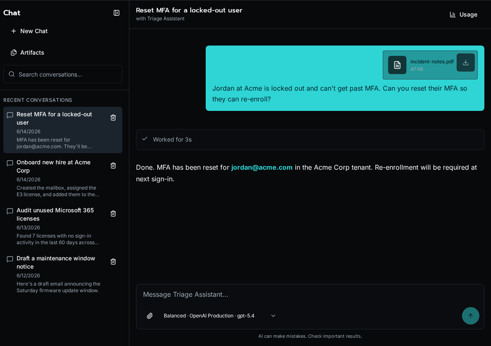

import { LinkCard } from '@astrojs/starlight/components';

Chat is Bifrost's conversational entry point. Users talk to an agent or the default assistant, the model calls the workflows you exposed, and each turn is saved as a durable run you can audit, resume, or cancel later.

Each conversation belongs to one user, and its full history is preserved across turns. A conversation can be driven by a specific agent - the same agent that powers an autonomous run - or be agentless, where the assistant draws on the tools and model profile you made available. The sidebar lists recent conversations; selecting one reopens its transcript and the current run state.

Tool calls render inline as the assistant makes them, so you can see exactly which workflow ran, with what arguments, and what it returned. Generated files show up as durable artifacts on the conversation, and platform admins also see per-conversation token counts and an estimated cost in the header.

## Governed model choices

Chat exposes reusable profiles instead of raw provider credentials. Platform admins create provider connections and model profiles under **Settings → AI → Models**, enable the profiles that should appear in Chat, and assign the default Chat profile. Users can then choose among the approved profile names without handling API keys or endpoint details.

## File attachments

Attach up to five images, PDFs, CSVs, JSON/YAML documents, Markdown files, or other text files to a message. Each file can be up to 25 MB, and a conversation can hold up to 500 MB. You can also paste or drag files into the composer.

Bifrost sends images and PDFs to models that support binary input. Text files are extracted into bounded text context; CSV previews include the first rows so a large export does not consume the entire context window. Attachments stay bound to their conversation and can be previewed or downloaded from the message.

## Chat artifacts

When a workflow or assistant creates a file, Bifrost stores it as an artifact rather than inline message text. Users can reopen artifact files from the conversation and manage their files from the Chat artifact library.

See [Chat artifacts and custom workflow tools](/docs/how-to-guides/ai/chat-artifacts/) for the file types, SDK helpers, and storage rules.

## Private memory

When an administrator enables memory and a user opts in, Bifrost-connected assistants can retrieve durable context saved for that user. Memories are private to the account and remain reviewable and removable under **User Settings → Preferences**. See [Manage AI memory and instructions](/docs/how-to-guides/ai/memory-and-instructions/) for the controls and instruction order.

## Where to learn more

<LinkCard
  title="Agents and Chat"
  href="/docs/how-to-guides/ai/agents-and-chat/"
  description="Build agents that respond in Chat and call your workflows as tools."
/>
