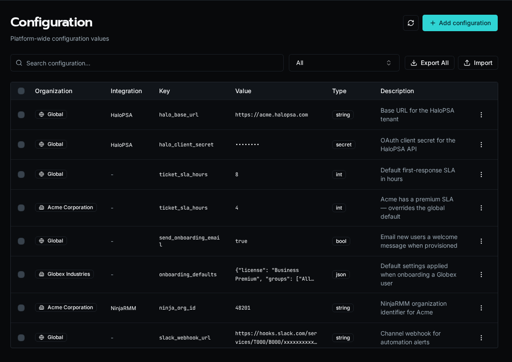

import { Aside } from '@astrojs/starlight/components';

Configuration is how you keep environment-specific values out of workflow code. Instead of hard-coding a HaloPSA URL or an SLA threshold, a workflow reads a named config key at runtime, and the value resolves against the organization the workflow is running for. The same workflow then behaves differently per customer without a code change.



## Config types

Each entry has a type that controls how the value is stored and rendered:

-   **string** — plain text, such as a base URL or an identifier.
-   **int** — a whole number, such as an SLA threshold in hours.
-   **bool** — `true` or `false`, for feature flags.
-   **json** — a structured object or array, for grouped defaults.
-   **secret** — an encrypted value (API keys, client secrets). Secret values are masked in the table and returned as `[SECRET]` in list responses; only workflow execution decrypts them.

## Global vs organization scope

A config is either **Global** (shared across every organization) or **org-scoped** (belongs to one organization). When a workflow runs, an org-scoped value of the same key overrides the global one. This is the same cascade every scoped resource follows — see [Scopes: Global vs Organization](/docs/core-concepts/scopes/) for how resolution works in workflow code.

In the example above, `ticket_sla_hours` is `8` globally but `4` for Acme — Acme's workflows see `4`, everyone else sees `8`.

<Aside type="note">
	Platform admins see all organizations' configs and can filter by organization. Members of a single organization see only that organization's configs plus the global defaults.
</Aside>

## Integration-managed configs

Configs tied to an integration show the integration name in a badge. These keys are defined by the integration's config schema rather than created by hand, and editing them updates the values the integration uses. Deleting the integration's schema removes the associated values, so manage them through the integration rather than the config table.

## Orphaned configs

When a [Solution](/docs/core-concepts/solutions/) is uninstalled, the config values it created are left behind rather than deleted, so you do not lose data the rest of your automations may still depend on. These appear with an **Orphaned** badge noting the solution they came from. They are hidden by default — toggle **Show orphaned** to review and clean them up.

## Reading config in a workflow

Workflows read config by key. The active organization context determines which value resolves:

```python
base_url = await config.get("halo_base_url")
sla_hours = int(await config.get("ticket_sla_hours"))
```

Before deleting a key, search your workspace for its usage — a workflow that reads a missing key fails at runtime:

```bash
rg -n "config.get\(.halo_base_url.\)" workflows/
```

## Managing configuration

Create, edit, and delete entries from the **Configuration** page, or script the same operations with the CLI:

```bash
bifrost config set halo_base_url --value "https://acme.halopsa.com" --type string --global
bifrost config set ticket_sla_hours --value 4 --type int --org <org-uuid>
bifrost config list
```

Platform admins can also **Export** selected keys and **Import** them into another environment from the same page.
