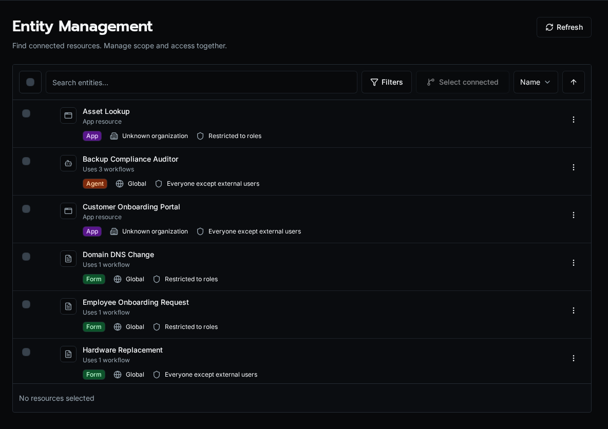

import { Aside } from '@astrojs/starlight/components';

Entity Management is one board for the scope settings that otherwise live on four separate pages. Every workflow, form, agent, and app appears in a single searchable list, and you reassign its organization or access level by dragging it onto a target. It answers the questions that span entity types: what does this customer actually have, what is shared globally, and what is unused.

## Why a unified board

Scope is a cross-cutting property. A new customer needs a handful of forms, an agent, and an app all moved into their organization at once; an offboarding sweep needs the inverse. Editing each entity on its own page is slow and easy to get half-done. The board collapses that into one drag — select many entities, drop them on an organization, and every one is rescoped in a single pass.

## The two columns

The left column is the entity list. The right column is the set of drop targets, split into two sections:

-   **Organizations** — every organization plus a **Global** target. Dropping entities here sets their `organization_id`, moving them between a customer's private scope and the shared global scope.
-   **Access Levels** — **Authenticated** (any signed-in user), **Clear Roles** (strip role assignments), and one target per role. Dropping entities here sets their access level or role-based grants.

<Aside type="note">
	Dropping onto **Global** clears `organization_id`, making the entity a shared default visible to every organization. See [Scopes](/docs/core-concepts/scopes/) for how the cascade resolves global versus organization-scoped resources at execution time.
</Aside>

## Filtering and search

The list combines four entity types, so filters keep it legible:

-   **Type** — workflow, form, agent, or app.
-   **Organization** — a specific customer, or **Global** for shared entities.
-   **Access** — authenticated versus role-based.
-   **Usage** — **In use** versus **Unused**, computed from each entity's dependency count.

The **Unused** filter is the fastest way to find dead entities before a cleanup. Combine it with a type filter to audit, for example, every form no other entity depends on.

## Relationship view

Select an entity's relationship action to filter the list down to everything connected to it — the workflows a form calls, the tools an agent uses, the entities an app renders. The same data drives a dependency graph dialog so you can see the chain before you delete or rescope a node. This is the safe way to check what breaks before removing a shared workflow.

## Bulk delete

Selecting entities also enables bulk delete. Forms, agents, and apps are removed directly. Workflows route through the deactivation flow: if a workflow is still referenced, Bifrost surfaces the dependents and offers replacements rather than silently breaking them. Delete is destructive — the relationship view exists so you can confirm the blast radius first.

## Who can use it

Entity Management is a platform-admin surface. It reassigns scope and access across every organization, so it is gated to administrators rather than per-organization members.
