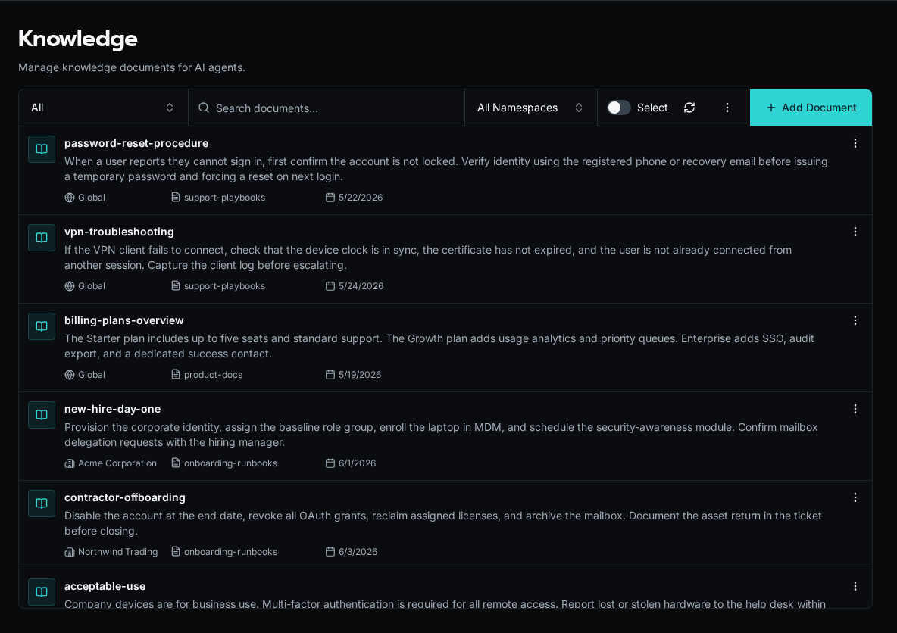

import { LinkCard } from '@astrojs/starlight/components';

Knowledge bases are collections of documents that Bifrost chunks, embeds, and indexes for semantic and full-text search. Bifrost fuses both rankings, so workflows and agents can recover conceptually related passages as well as exact names, codes, and product terms.

Documents are grouped into **namespaces** — named buckets like `support-playbooks` or `product-docs` that an agent or workflow targets when it searches. A query against one namespace never bleeds into another, so you can keep unrelated corpora isolated.

Each document also carries a **scope**. A *global* document is visible to every organization; an org-scoped document is visible only to that organization (and overrides a global document with the same key). This mirrors the cascade Bifrost uses everywhere else: org-specific content layers on top of shared defaults without duplicating it.

You manage knowledge through the platform UI and the SDK. Sources can be uploaded files, scraped pages, or programmatic ingestion from a workflow.

## Where to learn more

<LinkCard
  title="Knowledge Module (SDK reference)"
  href="/docs/sdk-reference/sdk/knowledge-module/"
  description="Query and manage knowledge bases from workflows using the bifrost.knowledge SDK."
/>
