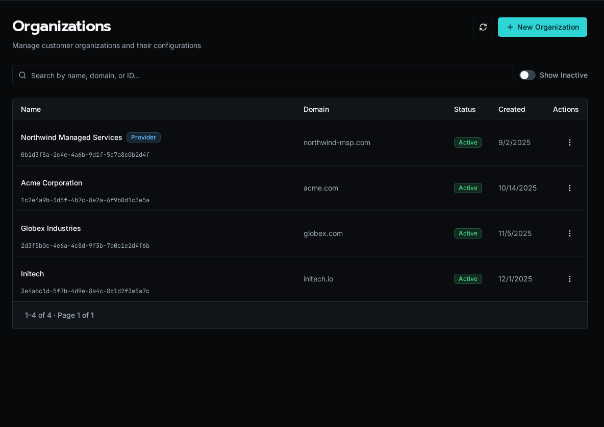

import { Aside } from '@astrojs/starlight/components';

An organization is the tenant boundary in Bifrost. As an MSP, you run one platform and represent each customer as an organization. Configs, OAuth connections, table rows, forms, and automations either belong to a single organization or are shared globally across all of them.



## The provider organization

One organization is marked as the **provider** — your own MSP. It is created automatically, cannot be disabled or deleted, and is highlighted with a star. Members of the provider organization can resolve and manage resources across every customer organization, which is how platform-wide automations and shared integrations work.

<Aside type="note">
	The provider flag is immutable. Everything else about an organization — name, domain, active status — can be edited after creation.
</Aside>

## Scope cascade

Every scoped resource resolves against the active organization first, then falls back to the global scope:

-   **Organization** (`organization_id = UUID`) — visible only inside that one organization.
-   **Global** (`organization_id = None`) — visible to every organization as a shared default.

A customer-specific OAuth connection or config overrides the global one of the same name when a workflow runs in that organization's context. See [Scopes: Global vs Organization](/docs/core-concepts/scopes/) for how this resolution works in workflow code.

## Email-domain auto-provisioning

Set an organization's **email domain** (for example `acme.com`) and any new user who signs in with a matching address is automatically placed in that organization. This removes manual user assignment for customers who use SSO.

## Active vs inactive

Disabling an organization keeps its data intact but takes it out of active rotation. Use the row menu to disable an offboarded customer, turn on **Show inactive** to find it later, and choose **Enable** to restore it. The provider organization cannot be disabled.

## Required AI instructions

Each organization can add instructions for work performed through the default Bifrost MCP endpoint. Open the organization's row menu, choose **Manage**, then select **Instructions**. Organization instructions are applied after the platform-wide instructions from **Settings → AI → Default MCP Instructions**.

Use this layer for durable customer context such as naming conventions, escalation rules, or approved operating boundaries. Do not put secrets in instructions.

## Managing organizations

Create, edit, enable, and disable organizations from the **Organizations** page, or script the same operations with the CLI:

```bash
bifrost orgs create --name "Acme Corporation" --domain acme.com
bifrost orgs list
```

The CLI's `delete` command performs the same soft-delete as **Disable** in the UI; it does not erase the organization's data.
