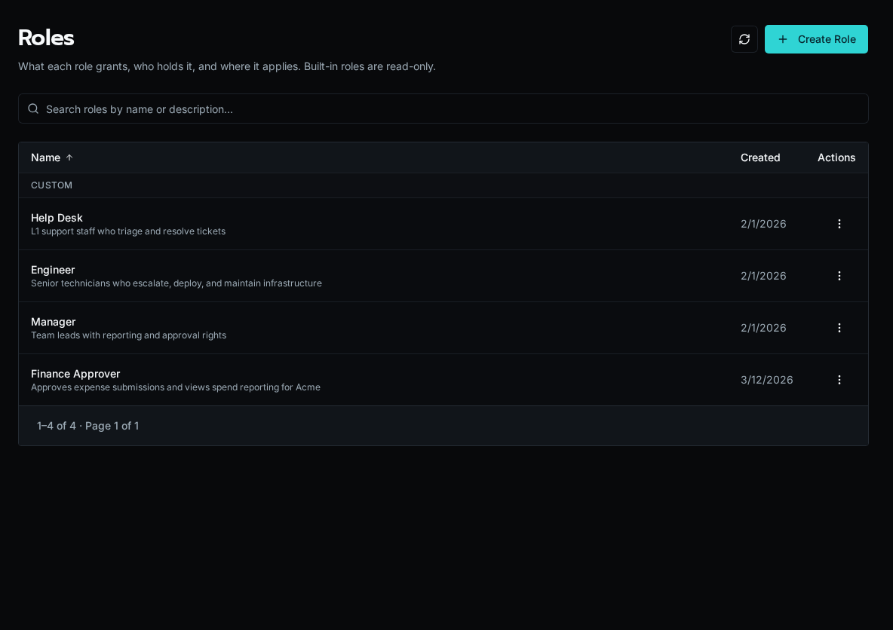
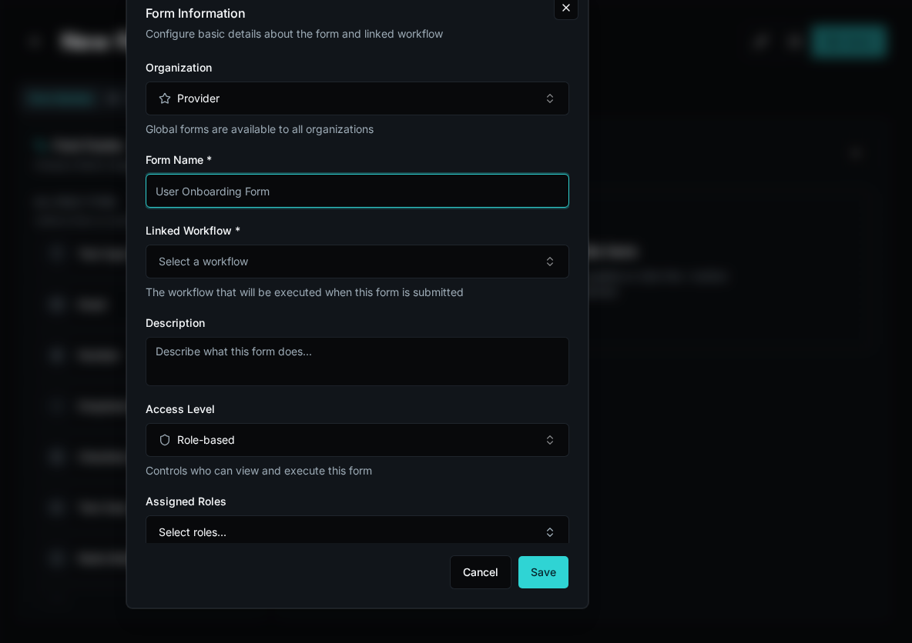
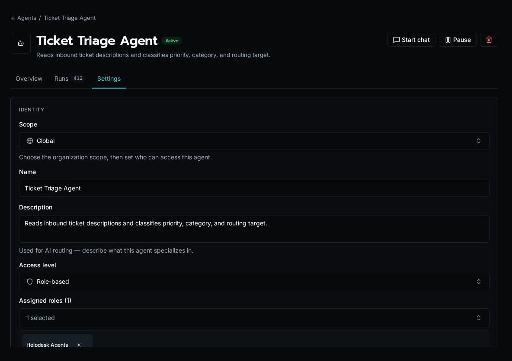
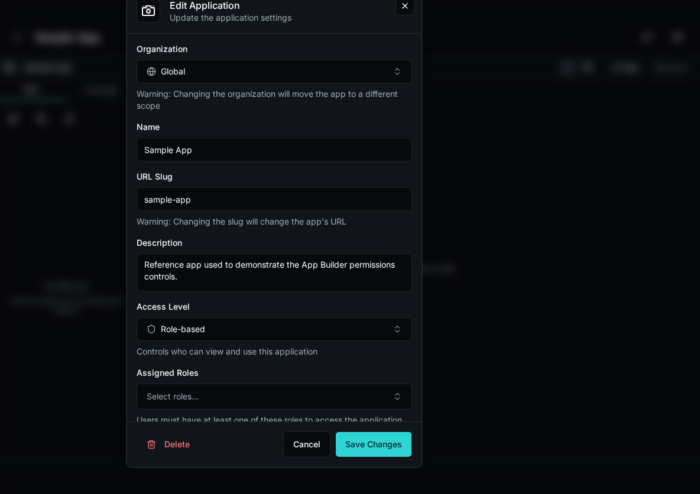
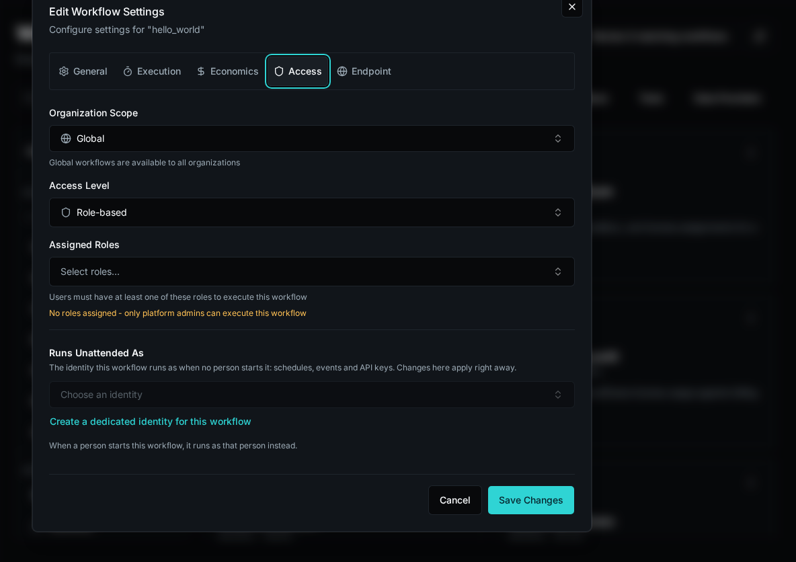

Bifrost checks both who may launch something and what its automation may do.
Access to an app, form, or agent does not grant unrestricted access to tables,
files, secrets, or integrations.

## Roles and Organization Reach

Roles grant named permissions. Their organization or platform boundaries determine
where those permissions apply. People and custom identities have a base role and
may have additional role assignments. Built-in roles are read-only; custom roles
let you define permissions for your own responsibilities.

Manage roles from **Roles** and assignments from **Users**. A provisioning default
chooses the base role for new accounts; changing that default does not rewrite
existing assignments. See [Base Role Defaults](/docs/how-to-guides/operations/base-role-defaults).

## Discovering and Launching Resources

An entity's access level, role bindings, and organization scope determine who can
see or launch it. Configure these on the form, workflow, agent, or app rather than
relying on a hidden button in a frontend.

Chat has its own permission. Access to an agent alone does not grant access to the
Chat surface. An app or form calling a workflow also passes through the workflow's
execution checks.

Set an agent’s launch visibility and role bindings in its access settings. Tool calls still use the underlying workflows’ execution permissions.

App access controls entry to the app; platform checks still apply to the operations it invokes.

## Run Users and Acting Identities

A run records its original user separately from its acting identity. **Run As**
changes who performs the action and receives its attribution; the original run
user's current roles and organization reach still decide whether it is allowed.
An acting identity cannot enlarge that reach.

Unattended workflows, agents, and services need a selected identity. Manage
reusable custom identities under **Users → Identities**, then select the appropriate
identity for the automation. A person's platform-admin status is not a substitute
for the run's permission checks.

## Workflow Access Modes

The workflow **Access** panel shows its effective mode:

| Mode | Permissions added to the run user's roles |
|---|---|
| **Full Access** | Every named permission, including Secrets, within the run user's organization reach. |
| **Declared Permissions** | Only the workflow's configured permissions, within the same reach. |

Full Access remains the platform default. Upgrading to 2.0 does not automatically
convert existing workflows to Declared Permissions.

Table and file policies still apply in either mode. Role conditions use the
original run user's own membership. Agents and inline scripts add no workflow
permissions. Solution outbound-access settings separately control network access.

The [workflow conversion tool](/docs/how-to-guides/workflows/converting-permissions)
can suggest declared permissions from code and recorded usage. Review uncertainties
and test normal execution paths before applying a narrower declaration. Its
analysis does not run workflows or prove their business behavior.

## Solution Permission Requests

A Solution declares each workflow's requested access mode and permission
capabilities. An administrator approves the request for that installation.
Changed requests require approval again; revoked or stale approvals add no
capabilities. Explicit Declared Permissions requests cannot inherit Full Access
from the platform default.

These capabilities add no organizations to the run user's reach. Existing Full
Access installs retain their mode until explicitly restricted.

## Checking Access

Use **Auditing → Access Checks** to inspect refusals and selected policy and
secret decisions. Successful named-permission checks are omitted, so this log is
evidence rather than a complete inventory of a workflow's needs.

Configure roles, reach, entity access, and workflow permissions together. Frontend
visibility and in-body checks can improve the experience, while platform checks
remain the authorization boundary.
