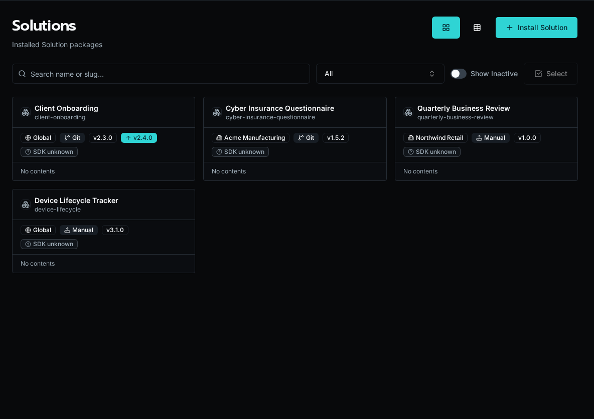
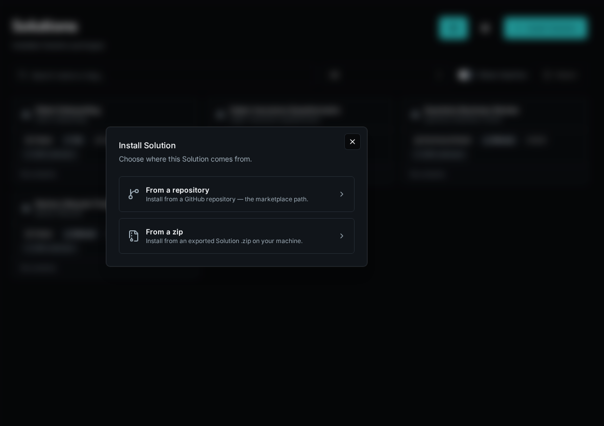
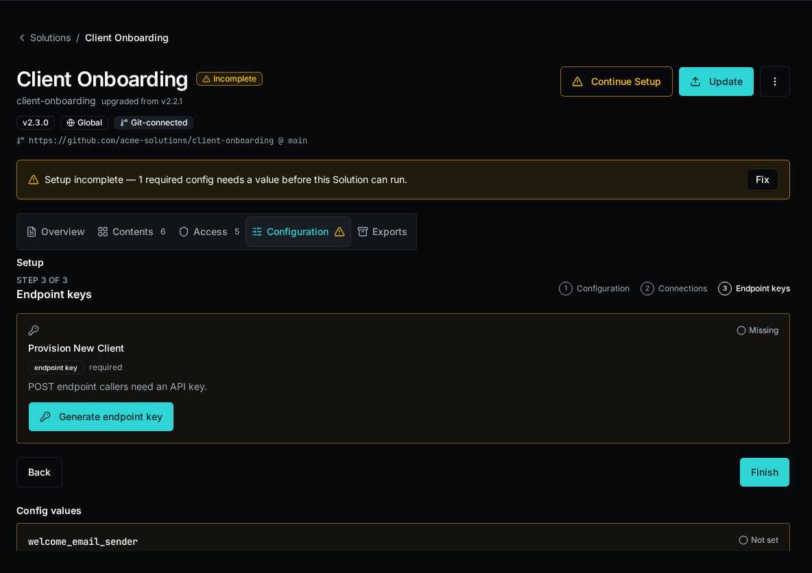

import { Aside } from '@astrojs/starlight/components';

A **Solution** is a packaged unit of Bifrost work — apps, workflows, forms, agents, tables, and config declarations — bundled behind a single identity so it can be installed into an org, updated over time, and removed cleanly. It is the answer to a recurring question: "I built this thing in one environment; how do I ship it to ten others and keep them in sync?"

Solutions replace the older `bifrost export --portable` / `bifrost import` flow. Those commands were removed. The portable-bundle approach moved files between environments but had no notion of *ownership*, *scope*, or *lifecycle* — once a bundle landed, the target environment couldn't tell which entities came from the bundle, couldn't protect them from drift, and couldn't update them as a set. Solutions close those gaps by treating the package as a first-class, server-tracked install.



## Why Solutions exist

Authoring a workflow or an app gives you one running thing in one place. Distributing it is a different problem. You want the same HR portal running for three customers, each with its own data and its own connection credentials, all built from one codebase — and you want a way to push a fix to all three without hand-editing entities in each environment.

A raw entity copy can't do this. It carries org IDs, role UUIDs, and OAuth tokens that are meaningless in another environment, and it leaves no trace of which entities belong together. Solutions solve the distribution problem by making the package the unit of management: identity, scope, ownership, and lifecycle all attach to the install, not to the loose entities underneath it.

## One definition, many installs

A Solution has two halves. The **definition** is the source workspace — Python source, app source, and the entity content in `.bifrost/*.yaml`, all keyed by a `slug` in the `bifrost.solution.yaml` descriptor. The **install** is what the server mints when you deploy: a `Solution` record with its own id, stamped onto every entity row the deploy writes.

The `slug` is the identity. One definition can produce many independent installs — deploy the same workspace into three different orgs and each gets its own install with its own id, its own config values, and its own entity rows, all built from the same source. Deploy refuses to let one org's install clobber another org's install of the same slug; each is resolved by matching `(slug, org)` and is updated independently.

<Aside type="note" title="Instance vs fork — the slug is the dividing line">
Need the *same* solution for another customer (same code, different data)? Keep one repo and one slug, and deploy it per org: `bifrost solution deploy --org "Customer Org"`. Each org gets an independent install of the same definition.

Need a customer's solution to genuinely *diverge* (different features, not just different data)? Fork the repo and give it a **new slug**. A different slug is a different definition — a separate solution, not another instance of the first. There is no per-customer stamping in the repo; forking is the mechanism.
</Aside>

## Deploy owns what it installs

Every entity a Solution installs — app, workflow, form, agent, table, config declaration — is **deploy-owned**. The platform writes these records at install or deploy time and treats them as read-only afterward. Editing a solution-managed entity through the live create/update verbs returns a `409`: deploy owns that record, and a stray live edit would silently diverge from the source the next deploy reconciles against.

Updates flow through the package, not the entity. You change the source workspace and run `bifrost solution deploy` (a full replace — the server upserts everything in the bundle and deletes managed entities no longer present). For git-connected installs the same update can arrive by auto-pull from the repo. The lifecycle is deliberate: the definition is the source of truth, and the install is a faithful, replaceable projection of it.

<Aside type="caution" title="Why read-only matters">
Because deploy is a full replace, a live edit to a managed entity isn't just unsupported — it's actively unsafe. The next deploy reconciles the install against the source bundle and would overwrite the edit. The `409` is the platform refusing to let you create that kind of silent drift. To change a managed entity, edit its content in the source workspace (`.bifrost/*.yaml` or the app/workflow source) and redeploy.
</Aside>

Capturing existing loose entities into an install is the one path that adds managed entities outside a normal deploy (`bifrost solution capture`). Even then, ownership is server-tracked: once captured, the entity is solution-managed and read-only like everything else the install owns.

## Three lifecycle modes

A Solution moves between environments three ways, depending on where the package lives and what you're doing with it.

**Install from a package.** An operator installs a finished Solution into their environment — from a workspace zip (`bifrost solution install <zip>`, the drag-and-drop equivalent) or from a GitHub repo. The server unzips or clones, resolves-or-creates the install for the chosen org, deploys the bundle atomically, and applies any config values supplied at install time. A source picker in the UI lets an operator install from a connected repo (including an omni-repo subfolder via `repo_subpath`).



**Deploy from a workspace.** An author ships their own source. `bifrost solution create` writes the descriptor, creates an empty remote install, and binds the workspace in `.env`; `bifrost solution bind --solution <id-or-unique-slug>` attaches a cloned workspace to an existing install. From that bound workspace, `bifrost solution deploy` (alias: `bifrost deploy`) bundles the Python source, workflow manifest, apps, forms, agents, tables, and config declarations, then POSTs them to the install. Deploy is non-interactive and always applies the full bundle, so the whole create → deploy → run loop runs headless.

**Local dev with `start`.** While building, `bifrost solution start` runs the app's Vite dev server and your local workflow functions behind a single origin (Firebase/SWA style). The app's first-run button works against locally-resolved functions with no deploy at all, and nothing ships to the server until you choose to deploy. It requires the workspace's `.env` binding so local runs read the install's own data plane (tables, configs) rather than the shared `_repo/` cascade.

## Scope: org or global

A Solution install is either scoped to one org or installed globally — and that scope is *not* a property of the definition. The `bifrost.solution.yaml` descriptor carries no scope. Install kind is the operator's deploy-time choice, set through the unified `--org` / `--global` standard, and the server derives scope from the install's `organization_id`: a concrete org id means an org-scoped install, `NULL` means global.

This keeps the package portable. The same source deploys org-scoped for one customer and globally for a shared library, with no per-environment edits to the descriptor. (Scope is independent of `global_repo_access`, a separate descriptor flag that controls whether the Solution's code may import shared modules from `_repo/` at runtime.)

## Connection references and setup

A Solution rarely runs in a vacuum — its workflows call integrations. A Solution **declares** the integrations it needs as connection references in its bundle. At install time the server pre-creates an empty integration shell for each declared connection and records it, so the operator can see exactly what the Solution needs before it will work.

Install surfaces unmet connection needs rather than failing silently mid-run, and a **Setup** wizard plus a required-config checklist guides the operator through supplying credentials and config values. The setup-status endpoint pairs every config declaration with whether a matching value exists in the install's scope; setup is complete only when every required declaration is satisfied.



Roles a Solution's entities bind to are auto-created on install or deploy if they don't exist in the target environment (empty, so an admin assigns members to grant access).

## The descriptor

`bifrost.solution.yaml` is the root marker that switches tooling into Solution mode and carries the definition's identity. It is stateless — no install id, no scope — and deliberately so: identity is minted server-side at deploy time and stamped onto entity rows, never stored in the repo.

```yaml
slug: hr-portal            # definition identity — the dividing line between instance and fork
name: HR Portal            # display name
version: 1.2.0             # bundle version recorded on the install at deploy time
global_repo_access: false  # may the code import shared _repo/ modules at runtime?
# git source (optional — for repo-installed / auto-pulled installs):
git_connected: false
git_repo_url: null
repo_subpath: null         # subfolder of an omni-repo holding this descriptor
git_ref: null              # branch/tag the install tracks
logo: null                 # path to an icon shown on the /solutions catalog
```

The descriptor *indexes* the per-entity content that still lives in the split `.bifrost/*.yaml` manifests; it does not replace them. A Solution workspace is the descriptor plus those manifests plus Python source plus app source.

### The version field and update-available

The declared `version` is recorded on the install at deploy time. Bifrost compares the bundle's version against the installed version to surface an **update-available** signal — the signal is descriptor-version based, not git-tag based, so an install knows a newer bundle exists without needing a release tag. The server's downgrade gate blocks a deploy whose version is older than what's installed unless you pass `--force`; versions it can't order never block.


## Exporting an install

An install can be exported back to a redistributable package with `bifrost solution export`. Two modes exist. **Shareable** (the default) rebuilds the workspace bundle live from the entities the install currently owns — code and schema, no secret values — and is directly re-installable. **Full** additionally carries an encrypted backup of the install's config values (and optionally table data) using Fernet encryption protected by a password; installing a full-backup zip requires that password to decrypt the secrets blob.

Because shareable export rebuilds *live* from current ownership, it always reflects the install's present state rather than the last deploy — which is also how `bifrost solution pull` materializes captured entities back into a source workspace.

## Where to go next

- [App Builder](/docs/core-concepts/apps/) — the apps a Solution packages and ships.
- Build a Solution end to end with the `bifrost solution` CLI: `create` (or `init` alias), `bind`, `scaffold-app`, `start`, `deploy`, `install`, `export`.
