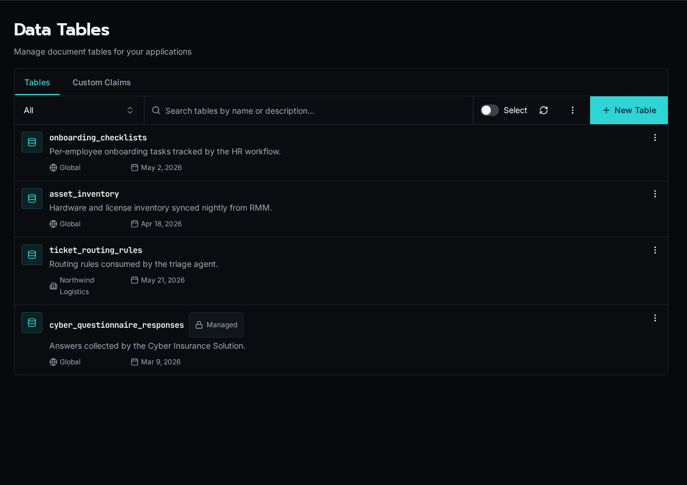
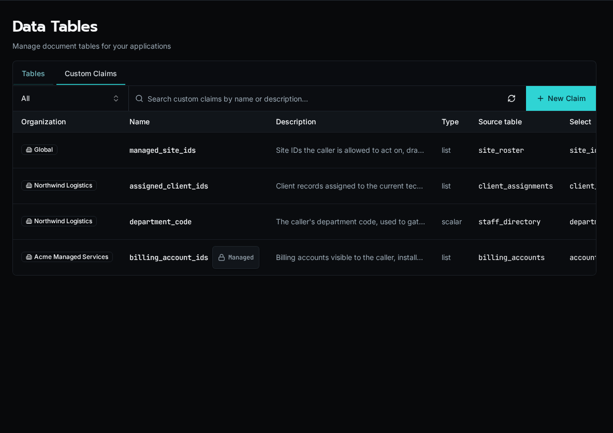

import { LinkCard, Aside } from '@astrojs/starlight/components';

Tables are Bifrost's built-in structured data store. Workflows, agents, and apps read and write rows through the SDK, giving you persistent state without having to spin up an external database.

Each table has a defined schema and is scoped to your platform. Rows are addressable by primary key and can be filtered, paginated, and updated from any workflow execution.



## Row-level policies

Every table carries a list of **policies** that gate read and write access on a per-row basis. A policy is a small rule that says "this user, on this row, may do this action." If no policy grants the action, the request is denied.

Policies live on the table itself (in the `access` column, surfaced as the `policies` field in the manifest and CLI). The same rules are enforced from REST, the workflow SDK, batch endpoints, and the live websocket fan-out — there is no surface where a row escapes the gate.

### Default-deny + the seeded `admin_bypass` rule

A freshly-created table is **deny-by-default**: nobody can do anything until at least one rule says so. To keep platform admins from locking themselves out, every new table is seeded with a single rule:

```yaml
policies:
  - name: admin_bypass
    description: Platform admins bypass all checks. Edit or delete to enforce stricter audit.
    actions: [read, create, update, delete]
    when:
      user: is_platform_admin
```

This rule is fully editable. You can remove it for tables that need stricter audit (e.g. customer financial data where even platform admins must satisfy a real rule), or leave it alone and add other rules alongside.

### The four actions are gated independently

Each row operation maps to one action:

| Action   | Triggered by                                         |
| -------- | ---------------------------------------------------- |
| `read`   | List/query, single-row GET, count, websocket events  |
| `create` | Insert (single or batch)                             |
| `update` | PATCH, upsert of an existing row                     |
| `delete` | DELETE (single or batch)                             |

Listing `[read, update]` on a rule does **not** imply `delete`. Each action is checked against the rules that name it explicitly.

### Multiple rules compose with OR

When several rules apply to the same action, they compose **additively** — if **any** rule grants the action, it's allowed. This is the pattern you'll use most often:

```yaml
policies:
  - name: own_row_read
    actions: [read]
    when:
      eq: [{ row: created_by }, { user: user_id }]

  - name: support_team_read
    actions: [read]
    when:
      call: has_role
      args: [support]
```

A user who created the row OR who has the `support` role can read it. There is no way to "subtract" — to remove access, remove or narrow the rule that granted it.

### Update and delete check the OLD row

When a row is updated or deleted, the policy is evaluated against the **pre-image** — the state of the row before the change. The post-image is not re-checked.

This has two consequences:

- **You cannot mutate a row to grant yourself read access to it.** A user who can't read a row also can't `update` it (the pre-image fails the check), so write-via-update exfiltration is blocked.
- **A user can mutate a row out of their own visibility.** If a rule says "read rows where `status = open`," a user with update can flip status to `closed` and lose visibility on their own row. The update was authorized at the moment it ran; the new state isn't re-evaluated for read.

If you want to prevent a row from being changed past a certain state, gate the `update` action itself on the pre-image:

```yaml
- name: only_open_can_be_edited
  actions: [update]
  when:
    neq: [{ row: status }, "closed"]
```

### List, GET, and websocket all use the same gate

A row that's filtered out of a list query is also unreachable via direct `GET /api/tables/{id}/documents/{row_id}` — the single-row endpoint runs the same `read` check against the row it loads, and returns 403 on deny. There is no enumeration sidechannel where a guessed ID returns a row that the list query hides.

The same is true for the live websocket fan-out: `useTable` and `tables.subscribe` only deliver events for rows that the user could read via the REST endpoint. If a row becomes visible to the user later (e.g. an admin re-assigns it), the user receives an `insert` event with no extra work on your side.

### Cross-org isolation is policy-driven

For **global** tables (no `organization_id` set on the table itself), there is **no implicit org filter** on the rows. A row's organization is whatever you put in the row's data. Cross-org isolation, when you want it, comes from a policy clause:

```yaml
- name: own_org_read
  actions: [read]
  when:
    eq: [{ row: organization_id }, { user: organization_id }]
```

This is a single line of defence — if the rule is missing or wrong, both users see both orgs' rows. Org-scoped tables (where `organization_id` is set on the table) get an implicit table-level scope, but the row-level rule is still recommended for defence in depth.

<Aside type="note">
Policy denials write a `policy.deny` row to the audit log so you can trace
"why can't user X read row Y?" without leaking row data into the response.
See <a href="/docs/how-to-guides/operations/audit-log/">Audit Log</a>.
</Aside>

## Custom Claims

A **custom claim** is a named, query-resolved fact about the caller that you can reference from any table policy with `{claims: name}`. Instead of repeating the same subquery in rule after rule, you define the lookup once and reuse it.



Each claim runs a lookup against a **source table** when the policy engine evaluates a rule, producing either a `list` (a set of values) or a `scalar` (a single value) for the current user. The query is the same `table` / `where` / `select` shape that policies use, so `{user: email}` and other principal fields are available inside the claim's filter.

Define the claim once — here `assigned_client_ids` selects every `client_id` from a `client_assignments` table where the assignment's `technician_email` matches the calling user:

```yaml
name: assigned_client_ids
description: Client IDs assigned to the calling technician
type: list
query:
  table: client_assignments
  where:
    eq: [{ row: technician_email }, { user: email }]
  select: client_id
```

Then reference it from any policy with `{claims: assigned_client_ids}`. The policy stays a single line and the membership logic lives in one place:

```yaml
policies:
  - name: own_client_rows
    actions: [read]
    when:
      in: [{ row: client_id }, { claims: assigned_client_ids }]
```

Claim resolution still obeys the source table's `read` policy. If an assignment table uses `row.user_id = user.user_id`, each caller's claim contains only their own assignment rows; a matching `user_id` field on any other table has no effect because policies belong to individual tables.

For access involving two dimensions, keep their pairing in one scalar key. A grant for site A/category X plus site B/category Y should produce keys `A:X` and `B:Y`, not independent lists that could also authorize `A:Y` and `B:X`:

```yaml
policies:
  - name: read_granted_documents
    actions: [read]
    when:
      in: [{ row: access_key }, { claims: allowed_document_access_keys }]
```

Build keys from immutable UUIDs. Keep the component UUIDs on each grant row too: component claims can filter reference tables for navigation, while the composite claim remains the protected-document boundary.

### Org-scoped vs global

Claims follow the same cascade as tables and configs:

- A claim with an **organization** set resolves only for callers in that org.
- A claim with **no organization (Global)** is visible to every org and can be overridden by an org-scoped claim of the same name — the org-specific definition wins for that org.

A `{claims: name}` reference in a policy resolves against whichever claim wins for the calling user's scope, so the same policy can mean different things per org without branching.

### Solution-managed claims

Claims installed as part of a [Solution](/docs/core-concepts/solutions/) carry a solution badge and are read-only in the UI — their lifecycle is owned by the install. Deleting a claim that a policy still references doesn't rewrite the policy: the next policy save that mentions the missing claim is rejected, so a dangling reference fails loudly rather than silently granting or denying.

## Where to learn more

<LinkCard
  title="Writing table policies"
  href="/docs/how-to-guides/tables/writing-policies/"
  description="Recipes for own-row, role-gated, org-isolated, and state-locked rules."
/>

<LinkCard
  title="Reading tables from an app"
  href="/docs/how-to-guides/tables/reading-from-apps/"
  description="Use the useTable hook for live-updating UI in custom apps."
/>

<LinkCard
  title="Tables Module (SDK reference)"
  href="/docs/sdk-reference/sdk/tables-module/"
  description="Read and write rows from workflows using the bifrost.tables SDK."
/>
