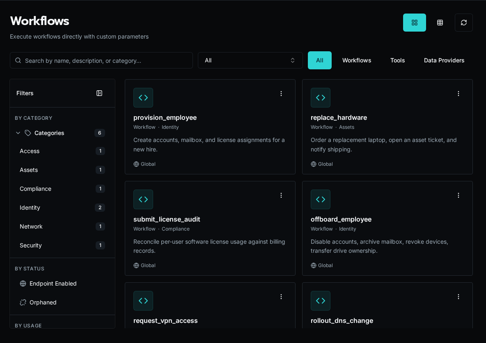

## What Are Workflows?

Workflows are Python functions whose decorators describe their functionality to the platform. The Workflows page shows all available workflows organized by category.



Workflows allow you to:

-   Define and accept parameters that can be exposed through forms or API calls
-   Execute business logic
-   Return results
-   Are registered explicitly via Code Editor, CLI, API, or an MCP agent

## How They Work

```python
from bifrost import workflow

@workflow
async def create_user(email: str, name: str):
    """Create a new user in the system."""
    # Business logic here
    return {"user_id": "123"}
```

The decorator automatically infers:
- **name**: from the function name (`create_user`)
- **description**: from the docstring
- **parameters**: from the function signature (type hints determine field types)

Any runtime controls such as timeouts, endpoint exposure, and recurring schedules are configured on the workflow record or via event sources after registration.

**Workflow lifecycle**:

1. Developer writes Python function with `@workflow` decorator
1. Developer registers the function via Code Editor, CLI, API, or an MCP agent
1. Workflow appears in the UI
1. Admins will usually create forms and tie them to workflows for execution
1. Users execute via forms
1. Results logged and displayed in realtime

## Key Concepts

### Registration

Workflows require explicit registration after creating the file. Write your code, then register the function using the Code Editor, `bifrost workflows register`, the `POST /api/workflows/register` endpoint, or an accessible MCP agent's workflow-registration tool.

Workflow files live in the `_repo/` workspace in object storage. Bifrost indexes registered metadata in the database and caches executable Python modules for workers; object storage remains the source of truth.

```text
_repo/
├── user_management.py
├── license_automation.py
└── reporting.py
```

See [Workflow Registration](/docs/core-concepts/discovery-system) for details on the registration process.

### Parameters

Parameters are automatically extracted from your function signature:

```python
@workflow
async def create_user(
    email: str,              # Required string
    name: str,               # Required string
    department: str = "IT",  # Optional with default
    active: bool = True      # Optional boolean
):
    """Create a new user."""
    pass
```

To use a data provider for a parameter, configure it in the form builder by selecting the data provider for the field. The form will populate the dropdown dynamically while the workflow receives the selected value:

```python
@workflow
async def create_user(email: str, department: str):
    """Create a new user."""
    pass
```

### Execution Context

Every workflow receives `ExecutionContext`:

-   Current user info
-   Organization context

### Invocation surfaces

Workflows can be triggered from several places:

-   Forms
-   API calls
-   HTTP endpoints, when enabled in workflow settings
-   Event sources, including recurring schedule sources

The decorator itself only carries the metadata needed for discovery. Runtime behavior lives in the workflow record or the event source that points at it.

## Workflow Categories

Organize workflows by purpose, defined completely by the developer.

## Multi-Tenancy

Workflows are organization-aware:

-   Access organization-specific data via `context.org_id` or `context.organization`
-   Use organization-scoped secrets and config

```python
@workflow(name="get_org_data")
async def get_org_data(context):
    # Automatically scoped to current org
    data = await db.query(
        "SELECT * FROM data WHERE org_id = ?",
        context.org_id
    )
    return {"data": data}
```

## Workflow vs Form

**Workflow**: Backend Python function (business logic)
**Form**: Frontend UI (user input collection)

Workflows can be:

-   Executed directly via API
-   Triggered by forms
-   Triggered automatically by event sources
-   Called from other workflows

Forms always execute workflows, but workflows don't require forms.

## State & Logging

Workflows are stateless but:

-   Log progress with Python logging
-   Return results
-   Use external storage for state
-   Capture runtime varialbes for troubleshooting purposes

```python
import logging

logger = logging.getLogger(__name__)

@workflow(name="process_items")
async def process_items(context, items: list):
    logger.info(f"Processing {len(items)} items")

    for i, item in enumerate(items):
        logger.info(f"Processing item {i+1}/{len(items)}")
        # Process item

    return {"processed": len(items)}
```

Logs appear in execution detail view.

## Error Handling

Workflows return error states (don't raise exceptions):

```python
@workflow(name="example")
async def example(context, param: str):
    try:
        result = await do_work(param)
        return {"success": True, "result": result}
    except Exception as e:
        return {"success": False, "error": str(e)}
```

This allows:

-   Partial success tracking
-   User-friendly error messages
-   Execution history

## Security

Workflows inherit user permissions:

-   Run as executing user
-   Access org-scoped resources only
-   Permission checks can be done via the context

```python
@workflow(name="admin_task")
async def admin_task():
    # Check permissions in the workflow
    if not context.is_platform_admin:
        return {"error": "Admin privileges required"}
    # Perform admin operation
    pass
```

## Next Steps

-   [Build Your First Workflow](/docs/getting-started/first-workflow) - Hands-on tutorial
-   [Writing Workflows Guide](/docs/how-to-guides/workflows/writing-workflows) - Complete guide
-   [Platform Overview](/docs/core-concepts/platform-overview) - Architecture
