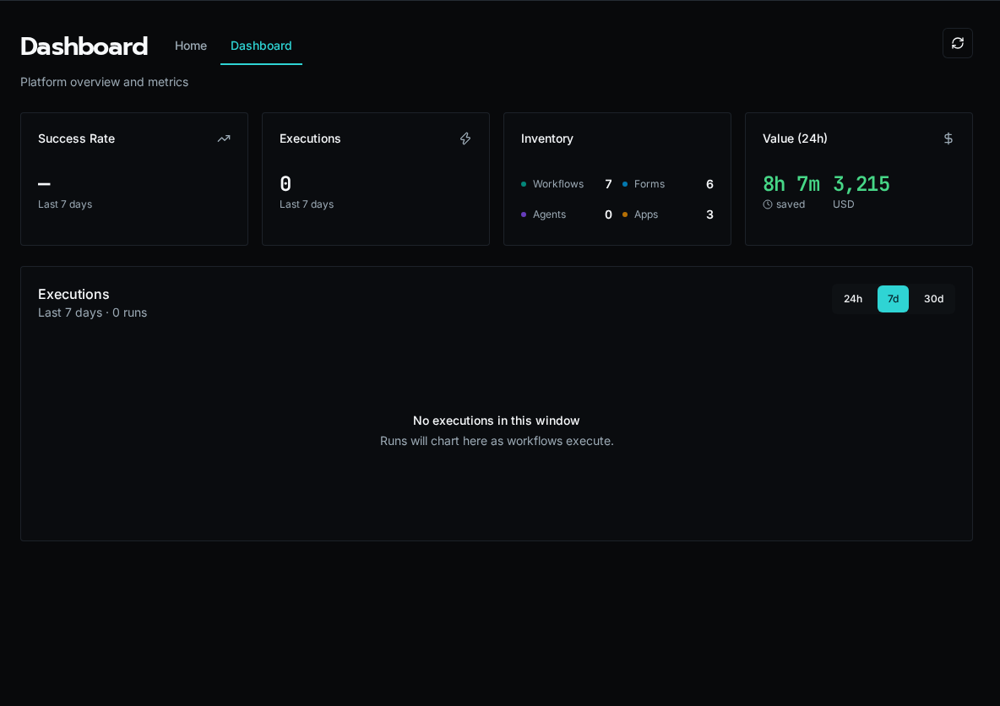

import { Steps, Aside } from "@astrojs/starlight/components";
import YouTube from "../../../../components/docs/YouTube.astro";

Prefer to watch first? This walkthrough covers installing Bifrost and a first look around.

<YouTube id="dAhyLk8cNTc" title="Getting Started" />

## Prerequisites

-   **Git**
-   **Docker** and **Docker Compose** installed
-   **8 GB of memory** on the host (recommended): the default stack runs two
    workers with a 2 GB limit each, plus the API, database and storage

<Aside type="tip">
    Docker Desktop includes Docker Compose. For Linux servers, install both
    separately.
</Aside>

<Aside type="tip" title="Windows 11">
    On Windows, use `Initialize-Bifrost.ps1` in native PowerShell instead of the
    Bash `setup.sh` — see [Windows 11 deployment](#windows-11-deployment) below.
    Docker Desktop must use the WSL2 backend.
</Aside>

## Quick Start

<Steps>

1. Clone the repository:

    ```bash
    git clone https://github.com/gobifrost/bifrost.git
    cd bifrost
    ```

2. Run the setup script:

    ```bash
    ./setup.sh
    ```

    This generates `.env` with secure random secrets for all services.

3. Start all services:

    ```bash
    docker compose up
    ```

4. Access the application at `http://localhost:3000`

    The first user to register becomes the Platform Admin.

    

</Steps>

### Windows 11 deployment

To deploy Bifrost on Windows, use native PowerShell — no WSL or Bash required.
Install Git for Windows and Docker Desktop (with the **WSL2 backend** enabled),
then:

<Steps>

1. Clone and enter the repository:

    ```powershell
    git clone https://github.com/gobifrost/bifrost.git
    cd bifrost
    ```

2. Run the PowerShell setup script:

    ```powershell
    .\Initialize-Bifrost.ps1
    ```

    It prompts for your domain, generates `.env` with secure secrets, runs
    `docker compose up -d`, and prints the access URL. Pass `-Domain` to skip
    the prompt; `-NoStart` to generate `.env` without launching.

3. Access the application at the printed URL (`http://localhost:3000` for a
    localhost deployment).

</Steps>

`Initialize-Bifrost.ps1` is the PowerShell counterpart to `setup.sh`; it
generates the same `.env` and needs no `openssl`, `sed`, or Git Bash.

<Aside type="note">
    Developing the platform itself (running `./debug.sh` / `./test.sh` against
    the source) is supported on Linux and macOS. On Windows those Bash scripts
    run through Git Bash or Ubuntu on WSL2, not native PowerShell. For CLI-only
    workflow development against an existing instance, see
    [Local Development Setup](/docs/how-to-guides/local-dev/setup).
</Aside>

If `winget` fails on a fresh Windows image with `0x8a15000f`, set the Windows
region, reset winget sources, then retry:

```powershell
Set-WinHomeLocation -GeoId 244
winget source reset --force
winget source update
```

## Architecture Overview

Docker Compose starts these services:

| Service       | Purpose                                                                 |
| ------------- | ----------------------------------------------------------------------- |
| **api**       | FastAPI application - handles HTTP requests and runs schedules          |
| **client**    | React frontend served via nginx                                         |
| **worker**    | Runs every kind of work: workflows, agent runs, and platform jobs (2 replicas, 2 GB each) |
| **postgres**  | Primary database, and the queue workers claim work from                 |
| **pgbouncer** | Connection pooler for PostgreSQL                                        |
| **redis**     | Sessions, cache, and sync execution results                             |
| **seaweedfs** | S3-compatible object storage for workspace files                        |

## Environment Variables

The `setup.sh` script generates all required secrets automatically. You only need to edit `.env` for optional features.

### Optional Configuration

| Variable                        | Description                                               |
| ------------------------------- | --------------------------------------------------------- |
| `BIFROST_DEFAULT_USER_EMAIL`    | Skip setup wizard by pre-creating admin                   |
| `BIFROST_DEFAULT_USER_PASSWORD` | Password for default admin user                           |
| `BIFROST_CORS_ORIGINS`          | Allowed origins for CORS (default: http://localhost:3000) |

### Single Sign-On (Optional)

SSO providers (Microsoft, Google, OIDC) are configured in the UI, not via environment variables.

See [Configure SSO](/docs/how-to-guides/authentication/sso) for setup instructions.

## Verify Installation

Check service health:

```bash
# View all container status
docker compose ps

# Check API health
curl http://localhost:3000/api/health

# View logs
docker compose logs -f api
docker compose logs -f worker
```

## Production Considerations

### Security

-   Generate cryptographically secure values for `BIFROST_SECRET_KEY` and `POSTGRES_PASSWORD`
-   Use a reverse proxy (nginx, Traefik, Caddy) with TLS termination
-   Consider using external secret management to populate `.env`

### Scaling Workers

Workers take work by memory, not by a fixed number of slots. Each worker
accepts runs that fit within 85% of its memory limit, using the memory each
workflow has learned it needs (or the **Memory Request** set in the
workflow's settings). The default `docker-compose.yml` runs two workers
limited to 2 GB each, which suits most high-memory jobs and leaves room for
agent runs; larger app builds may need more.

Increase worker replicas for higher throughput:

```bash
WORKER_REPLICAS=3 docker compose up
```

Or scale dynamically:

```bash
docker compose up -d --scale worker=3
```

For workflows that need more memory than a worker has, raise the worker's
memory limit in `docker-compose.yml` instead. Work that no worker can hold
fails at once rather than waiting.

### Kubernetes

For Kubernetes deployments:

-   See the `k8s/` directory for example manifests. Apply them with
    `kubectl apply -k k8s/`, which also grants the API the Role it needs to
    start worker Jobs.
-   The API starts worker Jobs as work arrives and stops them when idle. By
    default it keeps one warm and runs up to six, each with a 512Mi memory
    request and a 2Gi limit.
-   Run two API replicas and two client replicas. The API also runs schedules
    and starts the workers, and a second replica takes over within about 25
    seconds when one is lost.
-   Consider managed PostgreSQL, Redis, and S3-compatible storage

Set scaling and isolation in **Settings → Kubernetes → Scaling & Isolation**.
Changes apply without a restart:

-   **Scaling:** Warm Workers, Max Workers, Worker Memory, Largest Worker (the
    most memory a worker sized for a large run can get), and Idle Time.
-   **Isolated Jobs:** turn on **Isolate Build Jobs** to run build jobs, such
    as App and Solution deploys, each in its own pod, up to **Max Isolated
    Pods** at once, and choose which job types are isolated. With isolation
    off, these jobs run on workers.

Worker Jobs and isolated pods copy the API pod's namespace, image and
configuration, so they usually need no settings of their own. To override
that, set the `BIFROST_KUBERNETES_JOB_*` variables (for example
`BIFROST_KUBERNETES_JOB_IMAGE` or `BIFROST_KUBERNETES_JOB_SERVICE_ACCOUNT`);
the older `BIFROST_KUBERNETES_BUILD_*` names still work, with a startup
warning to rename them.

<Aside type="tip">
    Workers load workspace code from the shared cache and S3-compatible
    storage, so they scale without shared volumes.
</Aside>

See the [Kubernetes worker sizing
guide](https://github.com/gobifrost/bifrost/blob/main/docs/runbooks/kubernetes-worker-deployment.md#resource-sizing)
for measured memory use and draining behavior.

## Upgrading From an Earlier Release

Earlier releases ran a separate `scheduler` service alongside the workers and
used RabbitMQ (and, on Kubernetes, optionally KEDA) to queue work. Bifrost now
runs one kind of worker for every job type, schedules from the API, and queues
work in PostgreSQL.

### Docker Compose

An unchanged compose file keeps working: its `scheduler` service runs the same
worker, so it acts as a second worker. To switch to the current layout, take
the current `docker-compose.yml` (one `worker` service with two replicas and a
2 GB limit each), then retire the old `scheduler` container:

```bash
docker compose up -d --remove-orphans
```

Keep the `rabbitmq` service and the `BIFROST_RABBITMQ_URL` settings for the
first start after upgrading: the API moves any runs an earlier release left
queued there into PostgreSQL. Once the API logs
`Drained work queued by an earlier release`, delete the `rabbitmq` service,
its `depends_on` entries, the `BIFROST_RABBITMQ_URL` lines and the
`rabbitmq_data` volume from the compose file, remove `RABBITMQ_PASSWORD` from
`.env`, then run:

```bash
docker compose up -d --remove-orphans
docker volume rm bifrost_rabbitmq_data
```

`BIFROST_MAX_CONCURRENCY`, `BIFROST_MAX_WORKERS` and
`BIFROST_MAX_SERVICE_WORKERS` are no longer used; remove them if you set them.
The API logs a warning at startup naming every variable it no longer reads.

### Kubernetes

Apply the new base manifests with `kubectl apply -k k8s/`. They set the old
`bifrost-worker` and `bifrost-scheduler` Deployments to zero replicas, and the
API's worker Jobs take over. Once their pods are gone, delete them:

```bash
kubectl -n bifrost delete deployment bifrost-worker bifrost-scheduler
```

On first start, the API copies the scaling and isolation variables you set
(such as `BIFROST_POOL_MIN_WORKERS`, `BIFROST_POOL_MAX_WORKERS`,
`BIFROST_KUBERNETES_BUILD_MAX_JOBS` and `BIFROST_PLATFORM_BUILD_BACKEND`) into
**Settings → Kubernetes → Scaling & Isolation** once, and each imported value
shows the variable it came from. After that, those variables are no longer
read; the page lists any that are still set so you can remove them.

Keep RabbitMQ running until the API logs
`Drained work queued by an earlier release`, then remove the `rabbitmq`
Deployment and Service and any KEDA `ScaledObject` and
`TriggerAuthentication` that targeted `bifrost-worker`. See [Removing RabbitMQ
and KEDA after
upgrading](https://github.com/gobifrost/bifrost/blob/main/docs/runbooks/kubernetes-worker-deployment.md#removing-rabbitmq-and-keda-after-upgrading)
for the exact commands.

## Next Steps

-   [Create your first workflow](/docs/getting-started/first-workflow)
-   [Set up local development](/docs/how-to-guides/local-dev/setup)
-   [Configure OAuth integration](/docs/getting-started/integrations)
