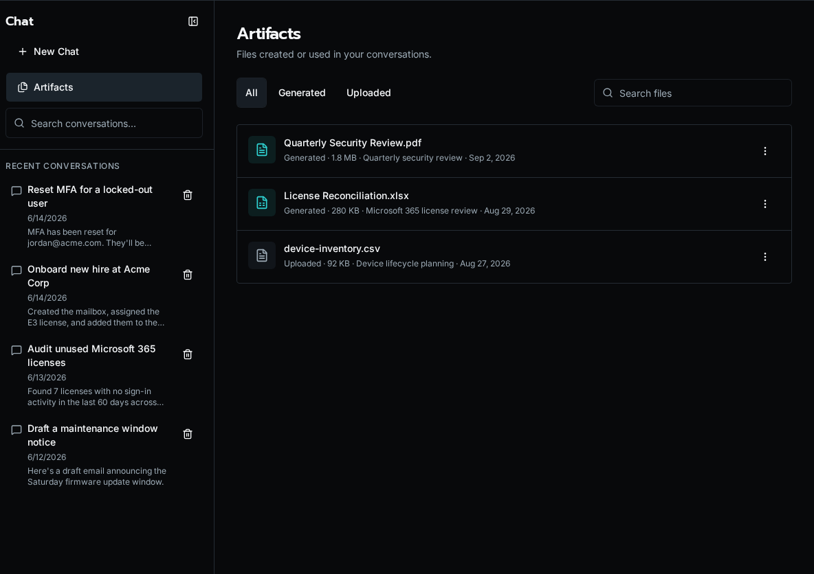

import { Aside, Steps } from '@astrojs/starlight/components';

Chat artifacts are durable files. A workflow or assistant creates one, Bifrost stores it, and Chat keeps the authorized reference attached to the conversation instead of copying bytes into the transcript.

## What counts as an artifact

Bifrost supports the built-in file types used by Chat and workflow tools:

- PDF and DOCX documents
- XLSX workbooks
- CSV, HTML, Markdown, JSON, and plain text
- Images
- Videos

Images and documents return as soon as the platform has the file. Video generation runs as a durable platform job; the SDK waits for completion and returns the same artifact reference, while the platform keeps progress durable if the original request disconnects.

## Return an artifact from a tool

<Steps>

1. Use the SDK helper that matches the file type you need.

2. Return the `ArtifactRef` the helper gives you.

3. Let Chat attach that reference to the message.

</Steps>

```python
from bifrost import artifacts, tool


@tool
async def create_customer_brief(customer: str):
    return await artifacts.create_document(
        f"{customer}-brief.pdf",
        format="pdf",
        title=f"{customer} brief",
        sections=[
            {
                "heading": "Decision",
                "paragraphs": ["Proceed with the proposed rollout."],
            }
        ],
    )
```

The public reference is opaque. It does not expose a storage key, path, or signed URL.

## Read an artifact in a later step

<Steps>

1. Accept the artifact as an input object.

2. Validate it with `ArtifactRef.model_validate(...)`.

3. Read the bytes with `artifacts.read(...)` and work from those bytes only.

</Steps>

```python
from bifrost import ArtifactRef, artifacts, tool


@tool
async def inspect_artifact(artifact: dict) -> dict:
    ref = ArtifactRef.model_validate(artifact)
    data = await artifacts.read(ref)
    return {"size": len(data)}
```

## Manage Chat files

Chat uploads and generated artifacts share the same workspace model. In the UI, users can upload files to a conversation and reopen generated files later from the message or library view.



Use the Chat API when you need to manage files directly:

- `POST /api/chat/conversations/{conversation_id}/attachments` uploads conversation files
- `GET /api/chat/artifacts` lists the current user's Chat files
- `PATCH /api/chat/artifacts/{attachment_id}` renames a Chat file
- `DELETE /api/chat/artifacts/{attachment_id}` deletes a Chat file

<Aside type="note">
Conversation uploads are for the next message in that conversation. Generated artifacts are returned by tools and stay available through the same workspace until retention or deletion removes them.
</Aside>
