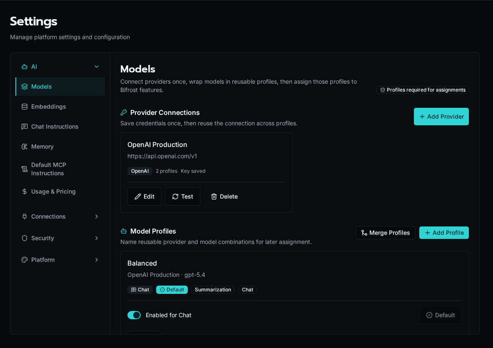

import { Aside, Steps } from '@astrojs/starlight/components';

Configure AI provider connections and reusable model profiles to enable workflows, agents, and chat.

## How Bifrost models AI

Bifrost separates AI setup into three layers:

- provider connections store the API key, endpoint, and provider kind;
- model profiles pair a connection with a specific model id;
- assignments choose which profile is used for workflows, summarization, tuning, image generation, video generation, and Chat.

Chat only shows profiles that are enabled for Chat. The Chat default is the profile assigned to `chat_default`.

## Supported providers

Pick **OpenAI**, **OpenRouter**, **Anthropic**, **Google**, or **OpenAI-Compatible** as the provider kind. Bifrost fetches model lists from the connected provider after you save the API key, so the model picker reflects what that account can actually reach.

Use **OpenAI-Compatible** for custom OpenAI-shaped endpoints such as Azure OpenAI, Ollama, LM Studio, Groq, or Together.

## Configure an LLM provider

<Steps>

1. Navigate to **Settings** > **AI** > **Models**.

2. Create a provider connection. Pick the provider kind, give it a name, and add the API key.

3. Leave **API Endpoint** at the provider default for the built-in providers. Use a custom endpoint for OpenAI-compatible or OpenAI-shaped services.

4. Create a model profile from that connection and choose the model id you want Bifrost to use.

5. Decide whether the profile should be available in Chat. If it should be the Chat default, assign it to `chat_default`.

6. Use **Test Connection** on the provider connection if you want to confirm the key and endpoint before saving the profile.

</Steps>

The Models page configures provider connections, reusable model profiles, and runtime assignments. The other AI settings pages cover embeddings, Chat instructions, memory, default MCP instructions, and usage pricing.

## Configure reusable profiles

Create one profile per provider/model combination you want to reuse. Profiles can carry capability metadata, and Bifrost uses that metadata in Chat to decide whether to offer tool calling, image input, and PDF input.

| Field | Meaning |
|---|---|
| Name | The label shown in the admin UI |
| Connection | The saved provider connection |
| Model | The provider model id |
| Enabled for Chat | Whether the profile appears in Chat |
| Capabilities | Optional metadata about tool calling, image input, and PDF input |

The first profile you save becomes the baseline for Bifrost's required assignments. After that, you can reassign each runtime slot independently without changing the profile itself.

## Chat defaults

The **Assignments** section maps a profile to each runtime use case. The important ones for day-to-day work are:

| Assignment | Used by |
|---|---|
| `primary` | General AI work and SDK completions |
| `summarization` | Summaries and background writeups |
| `tuning` | Agent tuning workflows |
| `image_generation` | Image generation workflows |
| `video_generation` | Video generation workflows |
| `chat_default` | The profile selected when Chat starts |

Chat only lists profiles with **Enabled for Chat** turned on. If the profile bound to `chat_default` is disabled, Bifrost keeps it enabled so the default Chat route stays valid.

## Capabilities

Capabilities are stored per profile and normalized against the exact provider/model/endpoint combination that produced them. If you change any of those three values, Bifrost treats the old capability record as stale and recomputes the profile as unknown until you verify it again.

Use the capability controls when you want to record whether a profile supports tool calling, image input, or PDF input. Verified capabilities come from a live probe; manual capabilities are for administrator-confirmed settings.

## Memory and required instructions

The **Memory** switch enables private, user-controlled memory for Bifrost-connected assistants. It depends on the embedding configuration. Users can still opt out and remove saved memories from **User Settings → Preferences**.

**Global Instructions** apply to every task performed through the default Bifrost MCP endpoint. Organization instructions are managed from each organization's **Manage → Instructions** tab and apply after the global layer. See [Manage AI memory and instructions](/docs/how-to-guides/ai/memory-and-instructions/).

## OpenAI-compatible endpoints

The **API Endpoint** field overrides the base URL passed to the provider SDK. Use it with **OpenAI-Compatible** for OpenAI-shaped services such as Azure OpenAI, Together, Groq, Ollama, vLLM, or LM Studio.

### Example: OpenRouter

OpenRouter exposes an OpenAI-compatible API and gives you a single key for models across many providers.

<Steps>

1. Set **Provider** to **OpenRouter**.

2. Leave the endpoint at `https://openrouter.ai/api/v1` unless you have a custom OpenRouter-compatible gateway.

3. Paste your OpenRouter key (`sk-or-...`) into **API Key**.

4. Click **Test Connection**. Bifrost calls OpenRouter's `/models` endpoint and populates the model dropdown with everything available to your key.

5. Pick the model id you want to reuse and save the profile.

</Steps>

<Aside type="tip">
OpenRouter model IDs include the upstream provider as a prefix (`openai/gpt-4o`, `anthropic/claude-sonnet-4-5`). Use the full prefixed ID when overriding `model=` per call.
</Aside>

### Other compatible endpoints

| Service | Provider type | API Endpoint |
|---------|---------------|--------------|
| Azure OpenAI | OpenAI-Compatible | `https://<resource>.openai.azure.com/openai/deployments/<deployment>` |
| Ollama (local) | OpenAI-Compatible | `http://localhost:11434/v1` |
| LM Studio (local) | OpenAI-Compatible | `http://localhost:1234/v1` |
| Groq | OpenAI-Compatible | `https://api.groq.com/openai/v1` |
| Together | OpenAI-Compatible | `https://api.together.xyz/v1` |

When the provider is OpenAI-shaped, Bifrost detects whether the endpoint supports the Responses API or needs Chat Completions and caches that choice on the profile. If you change the provider, endpoint, or API key, Bifrost clears the cached transport and probes again on the next request.

## Embedding configuration

For knowledge base / RAG features, configure embeddings:

<Steps>

1. In **Settings** > **AI** > **Embeddings**, open the embedding settings.

2. Choose to use the same provider as the LLM or configure separately.

3. For OpenAI, embeddings use `text-embedding-3-small` (1536 dimensions).

</Steps>

Embeddings can use a dedicated connection or inherit the provider connection from the LLM configuration. When the embedding model changes its vector size, Bifrost prompts you to re-embed existing knowledge rows before the new config takes effect.

<Aside type="caution">
Changing the embedding model changes the vector dimensions. If the knowledge store already holds rows embedded with the old model, Bifrost prompts you to **re-embed** them — search won't return those rows until they're re-indexed. Use **Reindex knowledge store** to re-embed on demand; progress shows in the notification center.
</Aside>

## Usage tracking

Bifrost tracks all AI usage:

- Input/output tokens per call
- Cost calculation based on configured pricing
- Aggregation by workflow, conversation, and organization

View usage and pricing in **Settings** > **AI** > **Usage & Pricing**. Broader operational usage reports are available under **Reports** > **Usage**.

## Pricing configuration

Configure per-model pricing in **Settings** > **AI** > **Usage & Pricing**:

| Field | Description |
|-------|-------------|
| Provider | Provider kind for the profile |
| Model | Model ID as returned by the provider |
| Input Price | Cost per 1M input tokens |
| Output Price | Cost per 1M output tokens |

<Aside type="note">
If pricing isn't configured for a model, usage is still tracked but costs show as $0. For OpenRouter, set pricing using the prefixed model ID (e.g. `anthropic/claude-sonnet-4-5`) so it matches what the SDK reports.
</Aside>

## Next steps

- [Using AI in Workflows](/docs/how-to-guides/ai/using-ai-in-workflows) — Completions and streaming
- [Knowledge Bases](/docs/how-to-guides/ai/knowledge-bases) — RAG with hybrid semantic and full-text search
