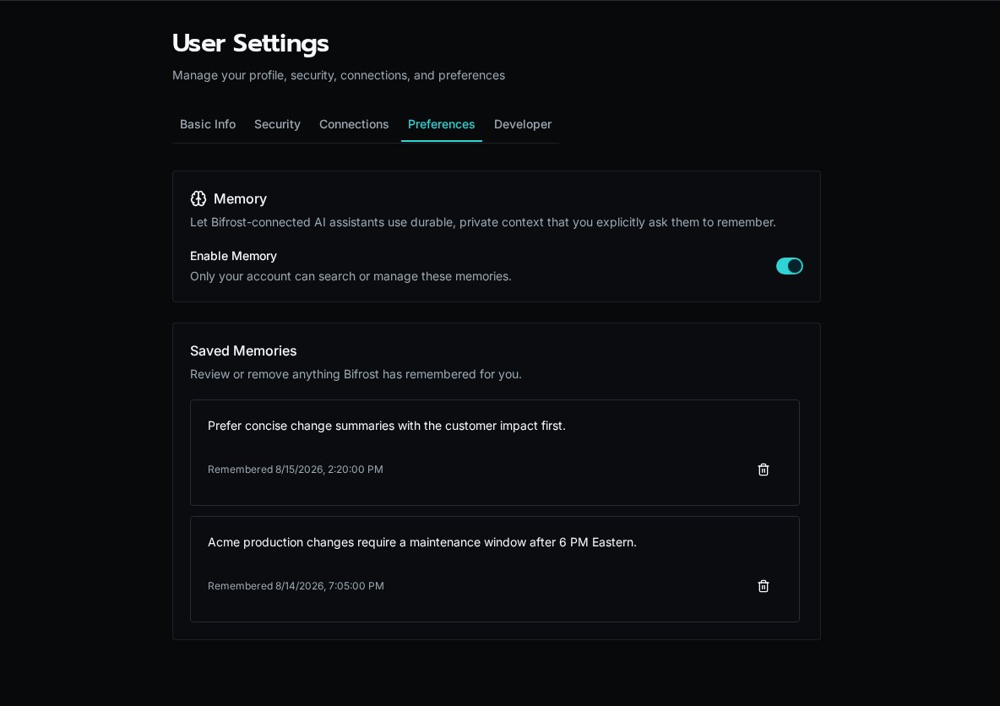
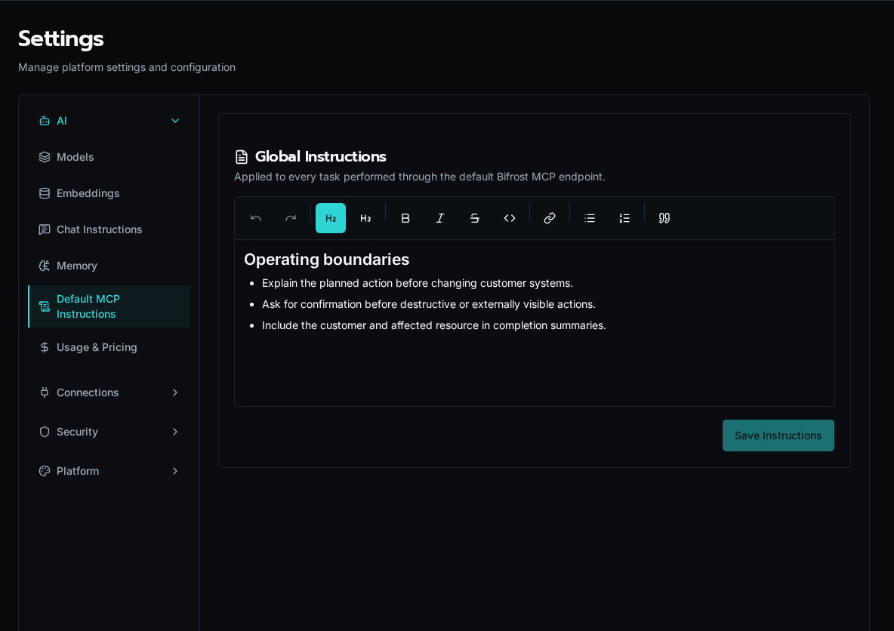

import { Aside, Steps } from '@astrojs/starlight/components';

## Enable memory for the platform

<Steps>

1. Open **Settings → AI → Embeddings** and configure an embedding connection and model.

2. Turn on **Enable Memory** in the Memory card.

3. Tell users they can opt in from **User Settings → Preferences**.

</Steps>

The platform switch is a ceiling: turning it off disables memory for everyone. Turning it on lets each user decide whether their own account participates.

## Manage your memories

Open **User Settings → Preferences**, turn on **Enable Memory**, and explicitly ask a Bifrost-connected assistant to remember durable context. The assistant tells you whenever it saves or removes a memory.

Saved memories are private to your account. Review them in **Saved Memories** and use the trash action to remove anything that should no longer be used. Turning memory off stops retrieval but does not silently delete saved entries.

<Aside type="caution">
Do not ask Bifrost to remember secrets, temporary task state, or unverified assumptions. Store credentials in encrypted configuration or connection fields instead.
</Aside>

## Set required instructions

Platform admins can add two editable instruction layers:

1. Add **Global Instructions** under **Settings → AI → Default MCP Instructions** for rules that apply to every task through the default Bifrost MCP endpoint.
2. Open **Organizations**, choose **Manage** for a customer, and use the **Instructions** tab for customer-specific context.

When memory is active, Bifrost resolves instructions in this order:

1. Built-in memory safety requirements
2. Global instructions
3. Organization instructions

Later layers add specificity; they do not remove the built-in safety requirements. Keep instructions durable and operational—for example, escalation boundaries, approved terminology, or customer-specific constraints.
