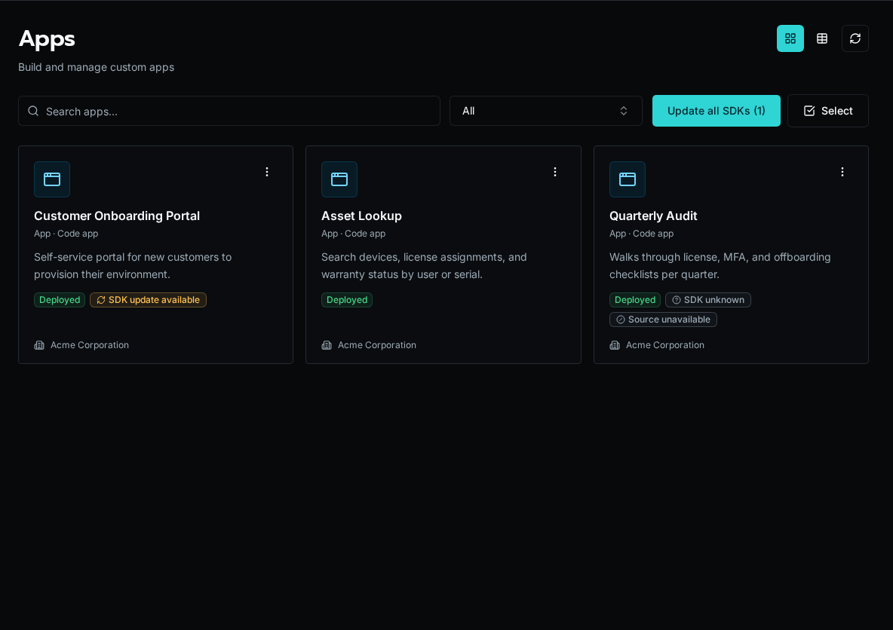

import { Aside, Steps } from "@astrojs/starlight/components";

A Bifrost upgrade does not silently replace the SDK inside an already deployed App. Bifrost compares each active V2 App build with the SDK on the current instance and shows when an update is available.

<Aside type="caution">
After upgrading to Bifrost 1.4, update deployed App SDKs so Apps using live table subscriptions understand the new batch-invalidation contract. Older bundles can miss live batch changes until the page reloads.
</Aside>

## Update Apps from the UI

<Steps>

1. Open **Apps** as a platform administrator. Apps built with an older SDK show **SDK update available**; deployments without recorded SDK provenance show **SDK unknown**.

2. Choose **Update SDK** from one App's actions menu, click **Update all SDKs**, or click **Select** to update a subset.

3. Follow progress in the App badge and Notifications. Bifrost builds a replacement artifact and switches the active deployment only after the build succeeds. A failed update leaves the previous deployment active and offers a retry.

</Steps>



## Update Apps in a Solution

Open **Solutions** to see the number of Apps with SDK updates in each install. Use the refresh action on one Solution, select several installs, or choose **Update all SDKs**. You can also update the Apps from a Solution's detail page.

An SDK-only update rebuilds the affected App artifacts from the retained deployed Solution archive. It does not pull Git, change the Solution version, reconcile the manifest, or modify sibling resources.

## Use the CLI

Inspect and update independent or otherwise visible Apps:

```bash
bifrost apps sdk status
bifrost apps sdk status <app>
bifrost apps sdk update <app>
bifrost apps sdk update --all
```

From a bound Solution workspace, inspect or rebuild the deployed install's Apps:

```bash
bifrost solution sdk deployed-status
bifrost solution sdk deployed-update
```

`bifrost solution sdk update` is different: it refreshes the SDK installed in the local development workspace.

## Resolve source-unavailable Apps

An App can be rebuilt only when Bifrost retained suitable deployment source. If the UI shows **Source unavailable**, redeploy the independent App or Solution from its source first. Bifrost 1.4 retains a sanitized archive from that deployment, excluding secrets, dependencies, build output, caches, and version-control data; later SDK updates can then rebuild in place.

## Read the SDK statuses

| Status | Meaning |
| --- | --- |
| **SDK current** | The active App uses the SDK bytes shipped by this Bifrost instance. |
| **SDK update available** | A different SDK is available and retained source can be rebuilt. |
| **SDK unknown** | The deployment predates SDK provenance or its SDK metadata is incomplete. Rebuild it when source is available. |
| **Source unavailable** | Bifrost cannot perform an SDK-only rebuild; redeploy from source. |

## See also

- [Develop and Deploy an Independent App](/docs/how-to-guides/apps/independent-apps/)
- [Update an Installed Solution](/docs/how-to-guides/solutions/updating/)
