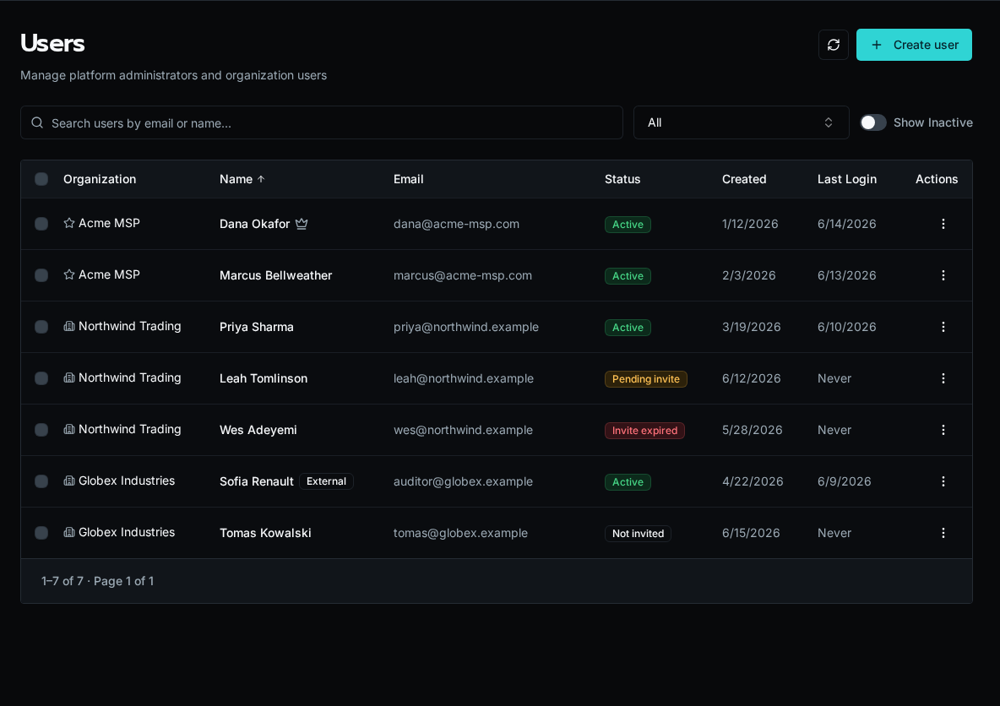

import { Aside, Steps } from '@astrojs/starlight/components';

The **Users** page is where platform admins create accounts, send registration invites, assign people to organizations, and disable or delete users. Each row shows the user's organization, invite status, and last login.

## Invite Status

Every user carries an invite status that tells you where they are in onboarding:

- **Active** — registered and able to sign in
- **Pending** — invited, link still valid, not yet accepted
- **Expired** — invited, but the registration link has passed its expiry
- **Never invited** — account exists with no invite issued yet

The status column is sortable, so you can group pending and expired invites together to chase them down.

## Invite a User

<Steps>

1. Click the **+** button in the top-right of the Users page.

2. Enter the email and name, then choose whether the user is a **platform admin** or a member of a specific **organization**.

3. Save. Bifrost creates the account and a registration link.

4. Copy the link from the dialog and send it, or — if an invite automation is configured (see below) — let Bifrost email it.

</Steps>

<Aside type="note">
Registration links expire. If a user reports an expired link, use **Regenerate** from the row's action menu to mint a fresh one.
</Aside>

## Row Actions

Open the action menu (⋯) on any row to:

- **Resend invite** — fire the invite automation again for a pending or expired user
- **Regenerate link** — create a new registration URL and show it for copying
- **Copy link** — grab the current registration URL
- **Revoke invite** — invalidate the pending link
- **Disable / Enable** — block or restore platform access without deleting data
- **Delete** — permanently remove the user and associated data

Disabling is reversible; deleting is not. Use **Show disabled** above the table to surface accounts you've turned off.

## Bulk Actions

Select multiple users with the row checkboxes (you can't select yourself). A bulk action bar appears with:

- **Move to organization** — reassign selected users to another org
- **Replace roles** — overwrite role assignments across the selection
- **Disable / Enable** — toggle access for everyone selected

If some users in a bulk operation fail, Bifrost reports the partial result so you can see exactly which rows succeeded.

## Automating Invite Emails

The invite **Resend** and **Send email** paths only deliver mail when a workflow or agent is subscribed to the `user.invited` event. Without a subscription, Bifrost still generates the link — you just copy and send it manually.

To automate delivery, create a **topic** event source for `user.invited` and subscribe a workflow that sends the registration email. See [Subscribe a Workflow or Agent](/docs/how-to-guides/events/subscriptions/).

## External Users

Users flagged **External** (portal or guest accounts) see only what the Everyone access tier or an explicit role grant allows — never global entities and never the standard "authenticated" entitlement. The External badge appears next to their name. For the full access model, see [Scopes](/docs/core-concepts/scopes/).
