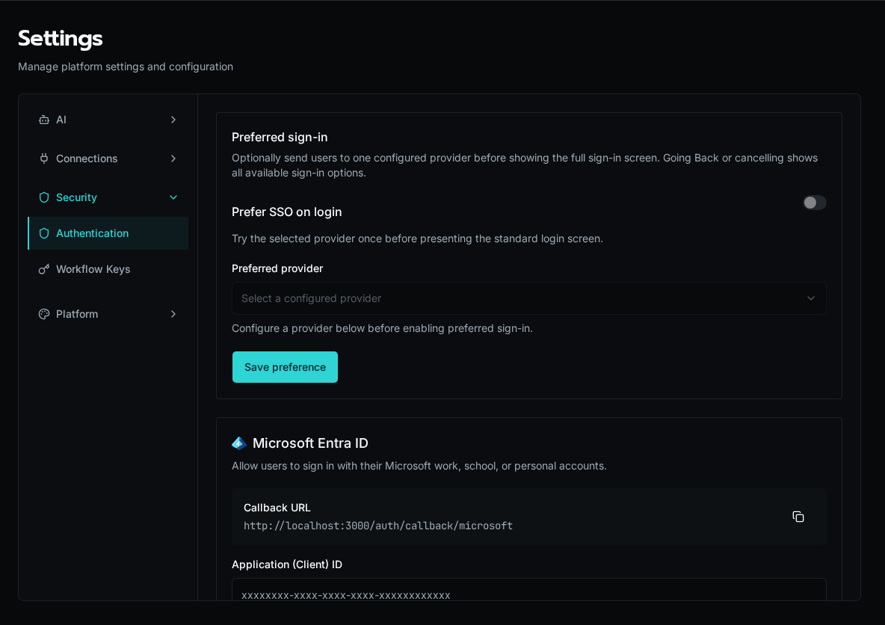
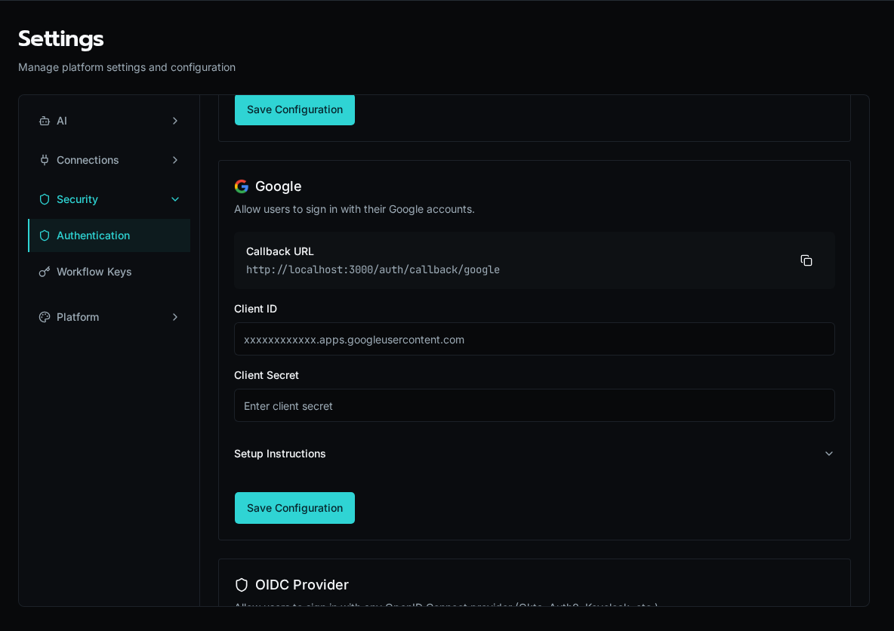
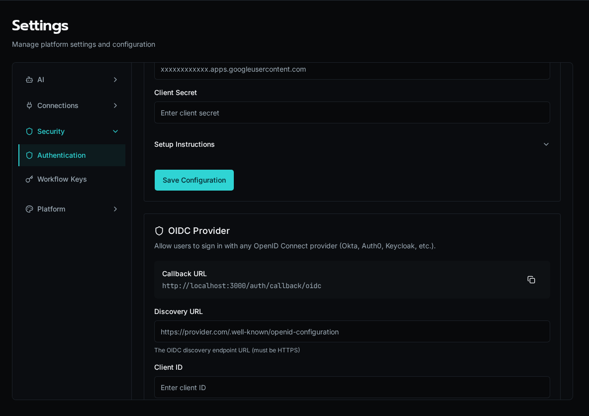
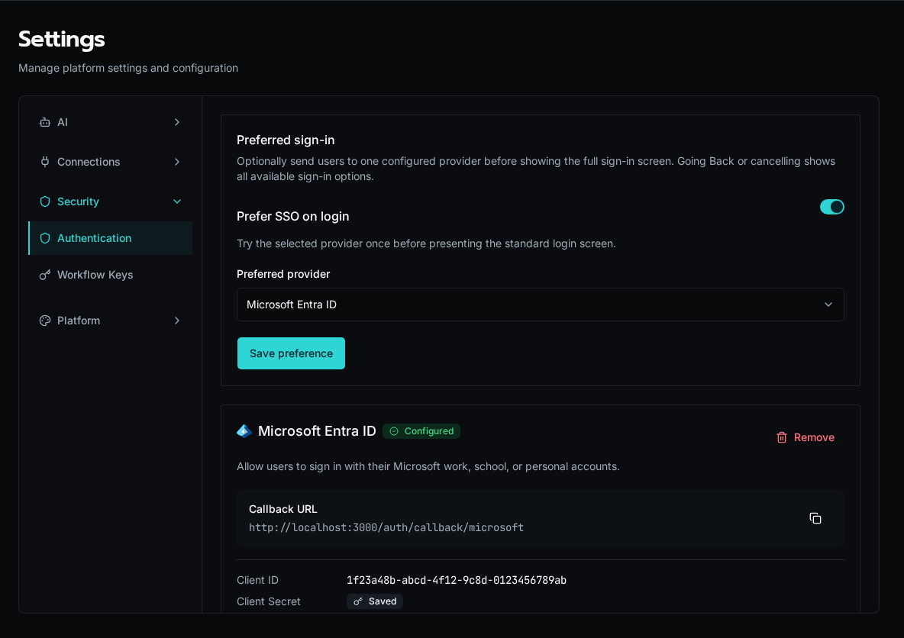
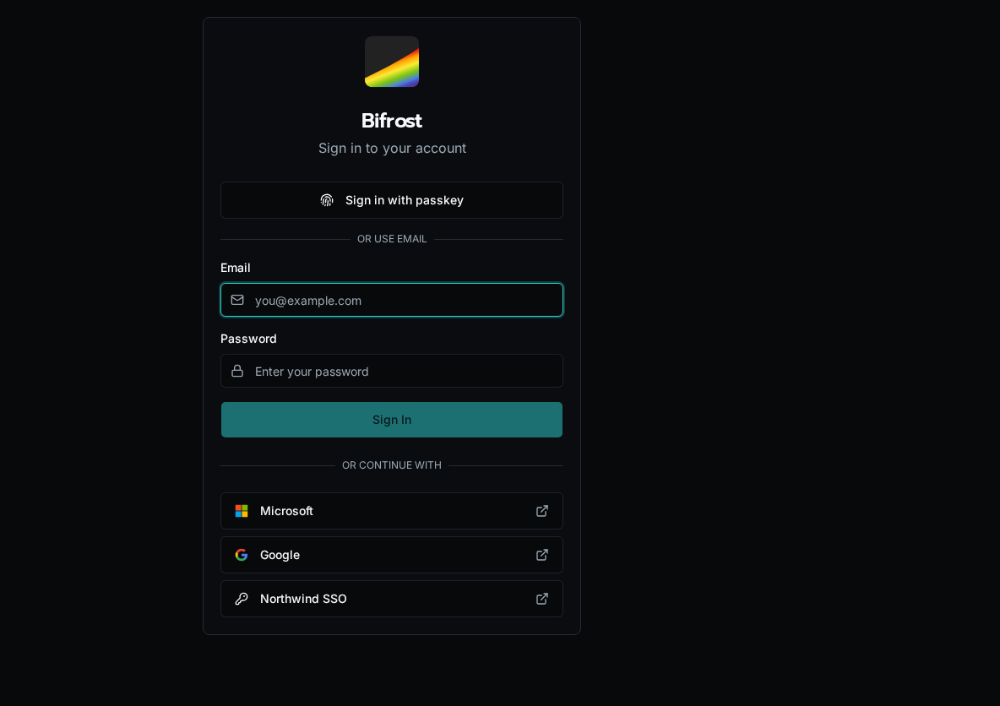

import { Aside, Steps, Tabs, TabItem } from '@astrojs/starlight/components';

Configure single sign-on (SSO) to allow users to log in with their existing identity provider.

## Overview

SSO is configured in **Settings > Authentication** within the Bifrost UI. All configuration is stored in the database—no environment variables are required.

Supported providers:
- **Microsoft Entra ID** - Azure Active Directory
- **Google Workspace** - Google accounts
- **Generic OIDC** - Any OpenID Connect provider

## Microsoft Entra ID

<Steps>

1. **Create App Registration in Azure**

   Go to [Entra ID](https://entra.microsoft.com) > **App registrations** > **+ New registration**:

   - **Name**: Bifrost SSO
   - **Supported account types**: Choose based on your needs:
     - *Single tenant* - Only your organization
     - *Multitenant* - Any Azure AD directory
   - **Redirect URI**: Web platform, `https://your-domain.com/auth/callback/microsoft`

2. **Configure Authentication**

   In your app registration, go to **Authentication**:

   - Ensure the Web redirect URI is correct

3. **Add Client Secret**

   Go to **Certificates & secrets** > **+ New client secret**:

   - Set description and expiration
   - Copy the secret value immediately (it won't be shown again)

4. **Note Required Values**

   From the **Overview** page, copy:
   - **Application (client) ID**
   - **Directory (tenant) ID**

5. **Configure in Bifrost**

   Go to **Settings** > **Authentication** and add Microsoft:

   - **Client ID**: Application (client) ID from Azure
   - **Client Secret**: The secret value you created
   - **Tenant ID**: One of:
     - Your specific tenant ID (single tenant only)
     - `organizations` (any work/school account)
     - `common` (work/school + personal Microsoft accounts)

   

</Steps>

<Aside type="tip">
The callback URL is shown in Bifrost under **Settings > Authentication**. Register that exact URL with the provider. Each provider has its own path; Microsoft uses `https://your-domain.com/auth/callback/microsoft`.
</Aside>

### Required Permissions

Microsoft SSO requests these scopes automatically:
- `openid` - Required for OIDC
- `profile` - User's display name
- `email` - User's email address
- `User.Read` - Basic user profile from Graph API

No admin consent is required for these scopes.

## Google

<Steps>

1. **Create OAuth Client in Google Cloud**

   Go to [Google Cloud Console](https://console.cloud.google.com) > **APIs & Services** > **Credentials**:

   - Click **+ Create Credentials** > **OAuth client ID**
   - Application type: **Web application**
   - Name: Bifrost SSO
   - Authorized redirect URIs: `https://your-domain.com/auth/callback/google`

2. **Configure OAuth Consent Screen**

   If prompted, set up the OAuth consent screen:

   - User type: **Internal** (Google Workspace only) or **External**
   - App name, support email, developer contact
   - Scopes: Add `email`, `profile`, `openid`

3. **Copy Credentials**

   After creating the client, copy:
   - **Client ID**
   - **Client Secret**

4. **Configure in Bifrost**

   Go to **Settings** > **Authentication** and add Google:

   - **Client ID**: From Google Cloud Console
   - **Client Secret**: From Google Cloud Console

   

</Steps>

<Aside type="caution">
For Google Workspace organizations, set the OAuth consent screen to **Internal** to restrict access to your domain only.
</Aside>

## Generic OIDC

Use any OpenID Connect-compliant identity provider (Okta, Auth0, Keycloak, etc.).

<Steps>

1. **Create Application in Your IdP**

   Register a new OIDC/OAuth application:

   - Application type: Web application
   - Redirect URI: `https://your-domain.com/auth/callback/oidc`
   - Grant type: Authorization Code

2. **Get Discovery URL**

   Find your IdP's OIDC discovery endpoint. Common formats:

   - Okta: `https://your-org.okta.com/.well-known/openid-configuration`
   - Auth0: `https://your-tenant.auth0.com/.well-known/openid-configuration`
   - Keycloak: `https://keycloak.example.com/realms/your-realm/.well-known/openid-configuration`

3. **Configure in Bifrost**

   Go to **Settings** > **Authentication** and add OIDC:

   - **Discovery URL**: Your IdP's `.well-known/openid-configuration` URL
   - **Client ID**: From your IdP
   - **Client Secret**: From your IdP
   - **Display Name** (optional): Custom text for the login button (e.g., "Sign in with Okta")

   

</Steps>

## Multiple Providers

You can enable multiple SSO providers simultaneously. Once all three are configured, the SSO settings page shows their status, and the login page surfaces a button per provider.

## Prefer one provider at sign-in

Enable **Preferred sign-in** to send users to one configured provider before showing the standard login form. Choose the provider in **Settings > Authentication**. If the provider is unavailable or the redirect fails, users return to the login page and can choose another sign-in method.

Keep the setting disabled when users regularly sign in through different providers or with local credentials.

## Troubleshooting

### Redirect URI Mismatch

Error: "redirect_uri_mismatch" or "invalid redirect"

The callback URL in Bifrost must exactly match what's registered in your IdP:
- Check for trailing slashes
- Verify protocol (https vs http)
- Confirm the domain is correct

### User Not Authorized

For Google with Internal consent screen or Microsoft with single tenant:
- Ensure the user's email domain matches your organization
- Check that the user exists in the directory

### Token Validation Failed

For OIDC providers:
- Verify the discovery URL is accessible
- Check that client ID and secret are correct
- Ensure the IdP's certificates are valid

## Security Notes

- All client secrets are encrypted at rest
- Tokens are validated server-side before creating sessions
- SSO sessions follow the same expiration as regular sessions
