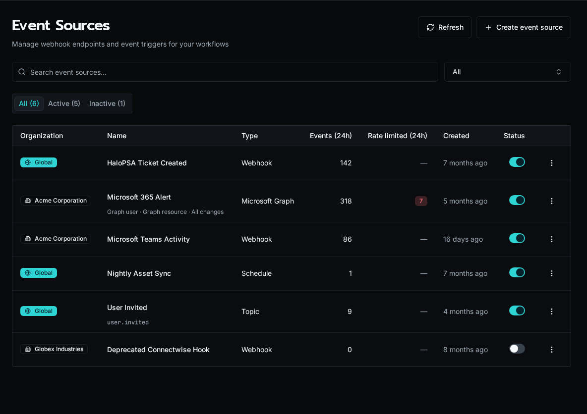

import { Aside } from "@astrojs/starlight/components";

Microsoft event sources are org-scoped webhook adapters. Use one when the event
starts in Microsoft 365 and you want Bifrost to normalize it into the event
system.

## Microsoft Graph

Use the `microsoft_graph` adapter for provider-managed subscriptions such as
mail, calendar, contacts, and other Graph resources.

- Requires a Microsoft integration and an organization scope.
- Configure a Graph resource, change types, and optionally a user.
- Bifrost creates the upstream subscription immediately.
- Graph validates the callback during creation, so the local source must exist
  before the provider call runs.
- A system schedule renews expiring subscriptions before Graph expires them.
- If renewal is rejected, Bifrost recreates the subscription.
- Deleting the source first unsubscribes the provider. If that cleanup fails,
  Bifrost keeps the local source and shows the error on the record.

<Aside type="tip">
Use subscriptions with an event-type filter when you only want one Graph
notification type, such as `created` or `deleted`.
</Aside>

## Microsoft Teams

Use the `microsoft_bot_framework` adapter for Teams bot activity events.

- Requires the bot's Microsoft App ID.
- Does not create or renew a provider subscription.
- Bifrost validates the incoming bearer token against the Bot Framework OpenID
  metadata.
- The request must come from the `msteams` channel and use the expected
  service URL and issuer.
- Normalized events carry `tenant_id`, `team_id`, `conversation_id`, `sender`,
  and the raw activity under `_event`.
- The emitted event type is `microsoft_teams.<activity_type>`.

<Aside type="note">
Teams sources are still org-scoped. Use payload filters on subscriptions if you
need to route different Teams activities to different handlers.
</Aside>

For one bot serving more than one customer tenant, configure tenant-to-
organization mapping before routing activities. See [Set Up a Shared Teams
Bot](/docs/how-to-guides/integrations/shared-teams-bot/).

## See also

- [Create an Event Source](/docs/how-to-guides/events/event-sources/)
- [Subscribe a Workflow or Agent to an Event](/docs/how-to-guides/events/subscriptions/)
