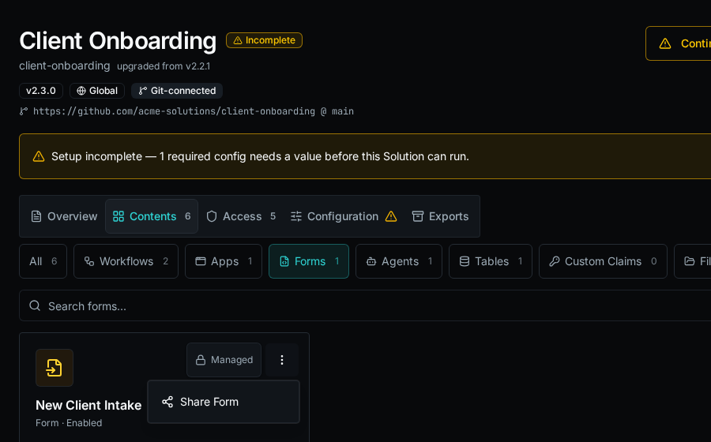
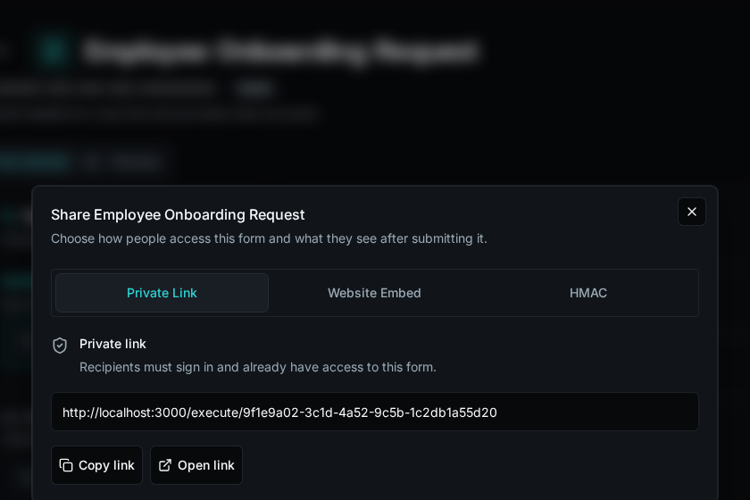
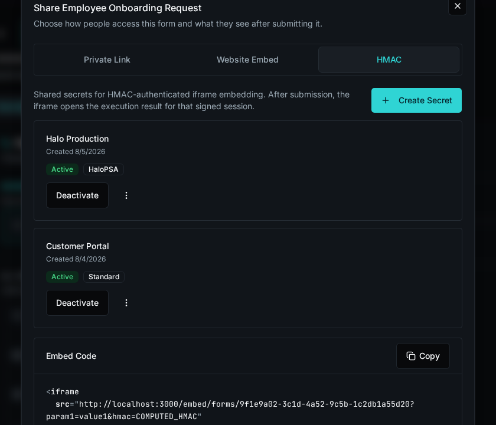
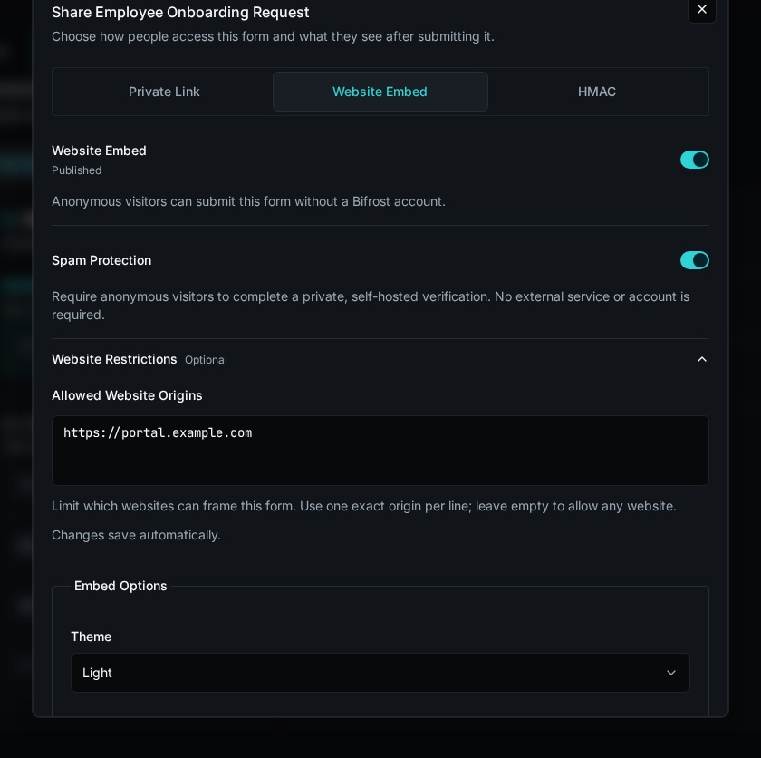

import { Aside } from "@astrojs/starlight/components";

## Open Share

From **Forms**, open the form's action menu and select **Share Form**. From the form builder, save the form and select **Share Form** in the toolbar.

Solution-managed forms are read-only in their installed environment, but sharing is environment-owned operational state. Open the installed Solution, select **Contents**, filter to **Forms**, and use **Share Form** on the managed form.



## Share a private link

Use **Private Link** when the recipient should sign in to Bifrost and use the form through normal form permissions.



1. Select **Private Link**.
2. Copy the private form URL.
3. Send it only to users who already have access to the form.

The private link does not bypass access control. If the user is not signed in, they are prompted to authenticate; if they do not have form access, Bifrost denies the request.

## Embed with HMAC

Use **HMAC** when another system should open the form for a verified external context, such as a PSA custom tab or customer portal that can sign iframe URLs server-side.



1. Select **HMAC**.
2. Select **Create Secret**.
3. Name the secret for the system or environment that will sign requests.
4. Choose the HMAC scheme:
   - **Standard** signs all query parameters and fits most integrations.
   - **HaloPSA** signs only `agent_id` for HaloPSA Custom Tab embeds.
5. Copy the generated secret when it is shown. Bifrost does not show it again.
6. Generate iframe URLs on your server by adding query parameters and a valid `hmac` signature to `/embed/forms/{form_id}`.

HMAC embed sessions are scoped to the form and the verified query parameters. The iframe opens the form without normal Bifrost chrome and, after submission, can show the execution result for that signed session.

### Signing contract

| Scheme | Message | Signature |
| ------ | ------- | --------- |
| **Standard** | Sort all query parameters except `hmac` by key, format each as `key=value`, then join with `&`. | Lowercase hex HMAC-SHA256. |
| **HaloPSA** | The `agent_id` value only. | Base64 HMAC-SHA256. |

```python
import base64
import hashlib
import hmac
from urllib.parse import urlencode


def standard_signature(params: dict[str, str], secret: str) -> str:
    message = "&".join(f"{key}={value}" for key, value in sorted(params.items()))
    return hmac.new(secret.encode(), message.encode(), hashlib.sha256).hexdigest()


def halopsa_signature(agent_id: str, secret: str) -> str:
    digest = hmac.new(secret.encode(), agent_id.encode(), hashlib.sha256).digest()
    return base64.b64encode(digest).decode()


params = {"agent_id": "12345", "ticket_id": "67890"}
params["hmac"] = standard_signature(params, "shared-secret")
iframe_src = f"https://bifrost.example.com/embed/forms/FORM_ID?{urlencode(params)}"
```

For HaloPSA, set `hmac` to `halopsa_signature(params["agent_id"], secret)`. Treat every query parameter except `agent_id` as unsigned in HaloPSA mode.

<Aside type="caution">
  Treat HMAC secrets like credentials. Rotate or deactivate a secret if it is exposed, and keep signing logic on a trusted server instead of in browser code.
</Aside>

## Embed on a public website

Use **Website Embed** when anonymous visitors should submit the form without a Bifrost account.



## Review public capabilities

Bifrost reviews the form before it can be published. The confirmation lists the submission workflow, launch workflow, data providers, and file fields that anonymous visitors can use.

Fix every **Cannot publish** blocker before continuing. Warnings do not prevent publication, but should be reviewed before making the form public.

<Aside type="caution">
  If a published form's workflow, providers, uploads, or field schema change, Bifrost pauses the public embed until you review and approve its capabilities again.
</Aside>

## Configure access

1. Select **Website Embed**.
2. Leave **Spam Protection** enabled to require Bifrost's self-hosted visitor verification.
3. Expand **Website Restrictions** and enter one exact allowed origin per line, such as `https://portal.example.com`. Leave the list empty only when any website may frame the form.
4. Turn on **Published** and approve the capability review.

Anonymous visitors can now submit the form without a Bifrost account. The public session is scoped to this form and its approved workflow, providers, uploads, and submission actions.

## Copy the embed code

1. Choose **Light**, **Dark**, or **System** under **Theme**.
2. Choose whether to show the form header or use a transparent background.
3. Select **Copy Embed Code** and paste the iframe into your website.

The appearance controls only change the copied iframe URL. They do not alter the saved form.

## Customize the confirmation

Under **Confirmation Message**, write the Markdown shown after a successful anonymous submission. Use **Preview** to check the result, then select **Update**.

## Rotate or disable access

- Select **Rotate** to invalidate the current public URL and generate a replacement.
- Turn off **Published** to stop anonymous public access.
- Deactivate an HMAC secret to stop signed embeds that use that secret.
- Keep private links, HMAC embeds, and public website embeds separate. Disabling one mode does not disable the others.

<Aside type="note">
  Solution updates can change a managed form's schema or workflows. If that changes a published form's approved public capability, Bifrost pauses the public website embed until an admin reviews and approves it again.
</Aside>
