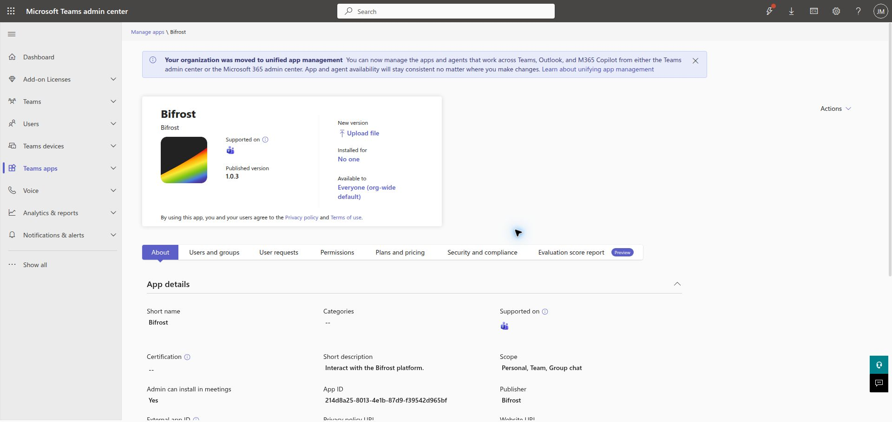

import { Aside } from "@astrojs/starlight/components";

Use this guide when one provider-operated Teams bot serves several customer
Microsoft 365 tenants. It installs the reusable Bifrost Teams transport, keeps
the bot credentials in provider scope, and maps every customer tenant to one
Bifrost organization.

The three identities have different jobs:

| Identity | Purpose |
| --- | --- |
| Bot home tenant | Obtains Bot Connector tokens for the shared bot. |
| Customer tenant | Supplies Graph access and the tenant-local Teams catalog app. |
| Bifrost organization | Receives that customer's authenticated Teams activities. |

## 1. Prepare the provider bot

Use an existing Teams-managed multitenant bot, or create one through the Teams
Developer Portal's **Tools** > **Bot management** flow. Teams-managed bots do
not require an Azure subscription; Microsoft documents that portal flow in its
[Developer Portal guide](https://learn.microsoft.com/en-us/microsoftteams/platform/concepts/build-and-test/manage-your-apps-in-developer-portal).

Record the Entra application (client) ID, client secret, and home tenant ID.
The bot must be multitenant (`isSingleTenant: false` / `AzureADMultipleOrgs`),
and Bot Connector authentication must use the home-tenant authority. Do not use
a customer tenant to obtain a token for the shared bot.

<Aside type="caution">
The existing provider deployment was verified as multitenant, but a new
registration was not retested from start to finish. Treat the portal as the
supported creation surface, then explicitly verify the Entra audience, Teams
channel, messaging endpoint, and home-tenant token authority before onboarding
customers.
</Aside>

## 2. Install the reusable Bifrost transport

Clone [the reusable Teams example](https://github.com/gobifrost/bifrost-community/tree/main/features/microsoft_teams), then run the following from its
`features/microsoft_teams` directory. Authenticate the CLI to the Bifrost
instance that will own the shared bot.

```bash
bifrost login --url https://<your-bifrost-url>
bifrost requirements install Markdown

bifrost files write modules/microsoft_teams_bot.py --from-file ../../modules/microsoft_teams_bot.py --create-only
bifrost files write features/microsoft_teams/workflows/messages.py --from-file workflows/messages.py --create-only
bifrost files write features/microsoft_teams/workflows/route_authenticated_event.py --from-file workflows/route_authenticated_event.py --create-only

bifrost workflows register --global --path features/microsoft_teams/workflows/messages.py --function-name send_teams_message
bifrost workflows register --global --path features/microsoft_teams/workflows/messages.py --function-name update_teams_message
bifrost workflows register --global --path features/microsoft_teams/workflows/messages.py --function-name delete_teams_message
bifrost workflows register --global --path features/microsoft_teams/workflows/messages.py --function-name send_teams_typing
bifrost workflows register --global --path features/microsoft_teams/workflows/route_authenticated_event.py --function-name route_authenticated_teams_event
```

Register these workflows globally. The `--org` argument on a send selects a
customer context; it does not retarget a workflow registered inside a customer
organization.

## 3. Configure Bifrost and the authenticated callback

Create one global `Microsoft Teams Bot` integration. Its defaults belong to the
provider and must be encrypted in Bifrost; never place bot credentials in a
customer mapping.

```bash
bifrost integrations create --name "Microsoft Teams Bot" --entity-id tenant_id --entity-id-name "Customer Entra tenant" --config-schema @integration.schema.yaml
bifrost integrations get "Microsoft Teams Bot" --json
bifrost api PUT /api/integrations/<integration-id>/config @home-defaults.template.json
```

The example's defaults contain `bot_tenant_id`, `client_id`, `client_secret`,
and an optional `bot_name`. `bot_tenant_id` is always the provider bot's home
tenant. The transport uses it for sends, replacements, deletes, and typing
indicators.

Create the shared Bot Framework event source and attach the router:

```bash
bifrost events create-source --global --name "Microsoft Teams Bot Framework" --source-type webhook --adapter microsoft_bot_framework --webhook-config '{"app_id":"<azure-bot-client-id>"}'
bifrost events subscribe "Microsoft Teams Bot Framework" --workflow route_authenticated_teams_event
bifrost events get-source "Microsoft Teams Bot Framework"
```

Use the callback URL returned by `events get-source` as the bot's messaging
endpoint. The adapter validates the Bot Framework bearer token and accepts
Teams activities before the router runs. The router takes no caller-supplied
activity: it reads the normalized authenticated event, matches
`activity.channelData.tenant.id` to exactly one mapping, scopes execution to
that organization, and emits `microsoft_teams.activity_received`.

Unknown and duplicate tenant mappings deliberately emit no customer event.
Subscribe customer-scoped workflows to `microsoft_teams.activity_received` for
the business behavior you need. Keep sender authorization separate from routing:
an authenticated Teams sender still needs a Bifrost role or application policy
before they can trigger ticket or agent actions.

## 4. Build the customer Teams package

Build a ZIP for the shared bot. The Teams package ID and the bot client ID are
different GUIDs: retain both. The package's `botId` and
`webApplicationInfo.id` use the shared bot client ID; the catalog assigns a
third, tenant-local ID when the app is first uploaded.

```bash
python3 package/build_package.py \
  --output /tmp/microsoft-teams-bot.zip \
  --app-id <teams-package-guid> \
  --bot-app-id <azure-bot-client-id> \
  --name "<bot-display-name>" \
  --developer-name "<provider-name>" \
  --website-url https://<provider-domain>/support \
  --privacy-url https://<provider-domain>/privacy \
  --terms-url https://<provider-domain>/terms \
  --valid-domain <provider-domain>
```

The builder produces a Teams 1.25 manifest with the required 192px color and
32px outline icons. Its package does not request resource-specific consent
(RSC). Add RSC only for a feature that needs it, such as reading channel
messages without an @mention; its installation or upgrade must then include the
matching consent set.

## 5. Publish the package in the customer catalog

A customer Teams administrator uploads the ZIP through **Teams apps** >
**Manage apps**. For a new package, choose **Upload new app** (sometimes under
**Actions**) and record the generated catalog app ID as that customer's
`teams_app_id` mapping value.

For an existing catalog app, open its details and choose **Upload file**. Keep
the package ID and bot client ID stable, increase the manifest `version`, and
upload the replacement ZIP. This is an update, not a new app upload; verify the
published version and that the catalog ID did not change.

The supplied builder emits version `1.0.0`. Before building an update, change
the `version` in its generated manifest definition, then rebuild the ZIP with
the same package ID and bot client ID.




These screenshots illustrate an existing app being updated from 1.0.3 to 1.0.4
in a development catalog. They do not show a new registration or a fresh
automatic installation.

Microsoft documents the customer-admin [catalog upload and update
path](https://learn.microsoft.com/en-us/microsoftteams/teams-custom-app-policies-and-settings),
including **Upload file** for updates. Microsoft Graph catalog publication and
[package update](https://learn.microsoft.com/en-us/graph/api/teamsapp-update?view=graph-rest-1.0)
use a delegated customer-administrator session; the
[publish API](https://learn.microsoft.com/en-us/graph/api/teamsapp-publish?view=graph-rest-1.0)
does too. They do not accept an app-only token, and a CSP/GDAP token is not a
substitute for that direct delegated catalog session. Use the customer admin
upload path unless you have separately validated a delegated automation path for
that tenant.

## 6. Finish customer onboarding

### Grant the personal-install permissions

For the generic module's `target_type: "user"` flow, configure these **Microsoft
Graph application permissions** on the provider's shared multitenant app
registration:

| Permission | Why the module needs it |
| --- | --- |
| `User.ReadBasic.All` | Resolves the target user's UPN to an Entra user ID. |
| `TeamsAppInstallation.ReadWriteSelfForUser.All` | Lists, installs, upgrades, and removes this app in a user's personal scope without a signed-in user. |

The second permission is Microsoft's current least-privileged application
permission for the [install-app-for-user API](https://learn.microsoft.com/en-us/graph/api/userteamwork-post-installedapps?view=graph-rest-1.0). The package in step 4 has no RSC declarations, so it does not need an RSC `consentedPermissionSet` for this flow. If you add RSC later, change the install request and consent according to Microsoft's [installation contract](https://learn.microsoft.com/en-us/graph/api/userteamwork-post-installedapps?view=graph-rest-1.0).

The provider must add those permissions to the shared app registration before a
customer can approve them. A customer Entra Privileged Role Administrator or
Global Administrator then creates or finds the customer-tenant enterprise app
(service principal) for the shared client ID and grants tenant-wide consent:

1. Open `https://login.microsoftonline.com/<customer-tenant-id>/adminconsent?client_id=<shared-bot-client-id>` as that customer administrator.
2. In **Entra ID** > **Enterprise applications** > **All applications**, open
   the shared bot application by client ID, choose **Security** >
   **Permissions**, review the two application permissions, and select
   **Grant admin consent**.
3. Confirm the service principal exists in the customer tenant and that consent
   is granted before sending.

Microsoft documents [creating a customer-tenant enterprise app for a
multitenant application](https://learn.microsoft.com/en-us/entra/identity/enterprise-apps/create-service-principal-cross-tenant)
and [granting tenant-wide admin consent](https://learn.microsoft.com/en-us/entra/identity/enterprise-apps/grant-admin-consent).
A Cloud Application Administrator can manage many enterprise-app tasks, but
Microsoft Graph application permissions require a role authorized to grant
Graph app roles; use Privileged Role Administrator or Global Administrator for
this consent.

An existing Bifrost workspace that includes Microsoft CSP automation can create
the customer service principal and apply its approved permission set. That is
provider-specific automation, not a dependency or capability installed by this
generic Teams module. Use the manual consent path above when that automation is
not present.

### Add the customer mapping

Create exactly one mapping from the customer's Entra tenant ID to its Bifrost
organization. Its `entity_id` and `tenant_id` are the customer tenant ID. Set
`teams_app_id` to the catalog ID created in step 5.

```bash
bifrost integrations add-mapping "Microsoft Teams Bot" \
  --organization "<customer-org>" \
  --entity-id "<customer-tenant-id>" \
  --entity-name "<customer-name>" \
  --config @customer-mapping.template.json
```

The transport acquires Graph tokens for the mapped `tenant_id`, using the shared
bot credentials. Team and group-chat sends need their own Graph permissions and
acceptance tests; do not grant those broader permissions for a personal-only
deployment.

## 7. Install, send, and route a test activity

Choose a customer test user with an active Teams entitlement. An administrator
can manage the catalog while being unable to receive a Teams personal app, so
confirm that the test user can sign in to Teams before testing installation.

For an existing conversation, first run a dry run:

```bash
bifrost workflows execute send_teams_message --org "<customer-org>" --params '{"target_type":"conversation","conversation_id":"<known-conversation-id>","message":"Teams transport check","dry_run":true}'
```

To install the app for a customer user when needed, create the personal
conversation, and send a message, use their UPN or email address:

```bash
bifrost workflows execute send_teams_message --org "<customer-org>" --params '{"target_type":"user","user":"user@customer.example","message":"Bifrost Teams delivery check"}'
```

The module resolves the user in the customer tenant, checks the tenant-local
catalog app installation, installs it if absent, then creates the Bot Framework
conversation and sends the message. Use the exact `teams_app_id` from the
customer catalog; it is not the shared bot client ID.

Then test the customer workflow you subscribe to
`microsoft_teams.activity_received`:

1. Run the personal-send command above for the dedicated user. It installs the
   app if necessary, subject to the selected Graph permissions and catalog
   policy.
2. Reply from the Teams client after the proactive message arrives.
3. Confirm that the reply passed Bot Framework authentication, selected the
   expected single customer mapping, and invoked only the intended consumer.
4. Test an unknown tenant and a duplicate mapping; neither may invoke a
   customer workflow.
5. Repeat the inbound test in a second customer tenant before declaring the
   shared callback ready for production.

<Aside type="note">
Manual package update, personal message delivery, and cross-tenant Connector
send, update, typing, and delete operations have been verified with temporary
test activity. The test account already had the updated app before the current
preflight, so that evidence does not prove a fresh automatic installation.
Authenticated customer replies also reached the shared callback, and a controlled
replay completed tenant routing and the existing Teams reply workflow after its
Connector authority was corrected. This verifies the existing deployment; a
new provider registration and fresh installation were not retested.
</Aside>

## Troubleshooting

| Symptom | Check |
| --- | --- |
| `403` during installation | Confirm the customer catalog and installation policy, the tenant-local `teams_app_id`, the package's `webApplicationInfo` identity, and that the selected user is Teams-licensed. |
| The app update creates a second catalog entry | Keep the manifest package ID stable and use **Upload file** from the existing app details. |
| Connector authentication fails for a customer | Confirm `bot_tenant_id` is the provider bot's home tenant, not the customer tenant. |
| Activity is received but no customer workflow runs | Check the adapter authentication result, `channelData.tenant.id`, and that exactly one global mapping matches it. |
| A customer receives another customer's event | Stop rollout; remove the duplicate mapping and verify scope selection before re-enabling the consumer. |

## See also

- [Microsoft Event Sources](/docs/how-to-guides/events/microsoft-event-sources/)
- [Automate Microsoft 365](/docs/how-to-guides/integrations/microsoft-graph/)
