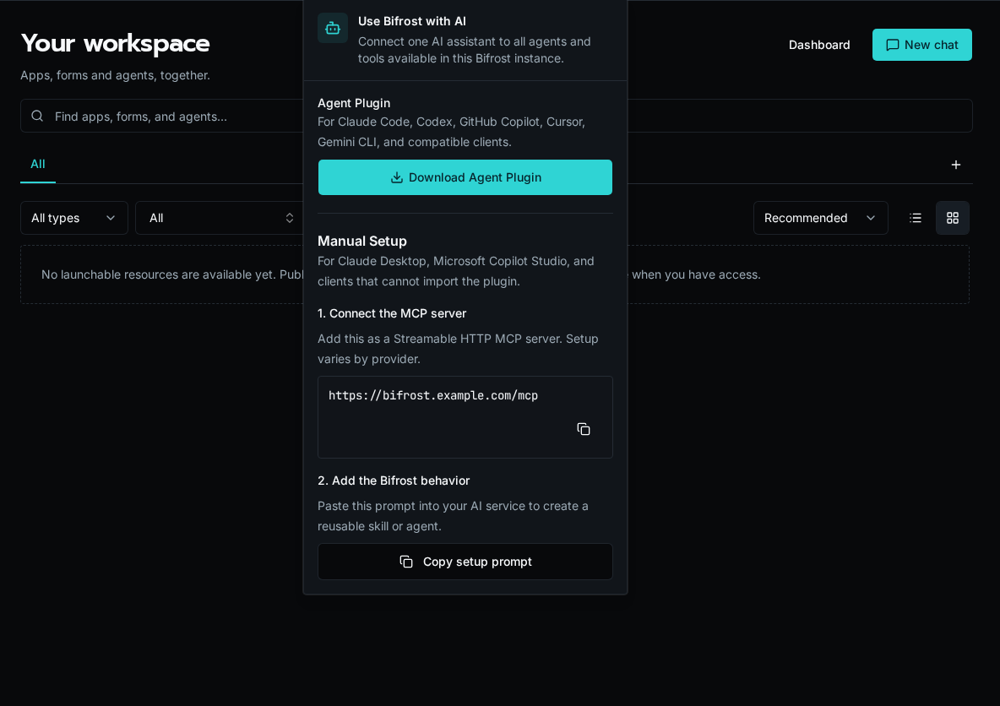

import { Aside, Steps } from '@astrojs/starlight/components';
import YouTube from '../../../../../components/docs/YouTube.astro';

Once Bifrost's MCP server is enabled (see [Server Setup](/docs/how-to-guides/mcp/server-setup)), any MCP-compliant client can connect. This page walks through Claude Desktop, GitHub Copilot, Cursor, and Open WebUI.

The general flow is the same for all of them:

1. Tell the client the MCP server URL (`https://your-instance/mcp`).
2. The client kicks off OAuth: it registers via `/register`, redirects you to Bifrost's login, and exchanges the code for a token.
3. The client receives Bifrost's four gateway tools. Those tools discover only the agents and capabilities your roles allow.

Using a coding agent like Claude Code or Codex to build on Bifrost? Start with [AI-Assisted Development](/docs/how-to-guides/local-dev/ai-coding/), or watch the walkthrough:

<YouTube id="PIK65NhtfB4" title="Connecting your coding agent" />

## Claude Desktop

<Steps>

1. Open Claude Desktop's settings file:
   - **macOS**: `~/Library/Application Support/Claude/claude_desktop_config.json`
   - **Windows**: `%APPDATA%\Claude\claude_desktop_config.json`

2. Add a `mcpServers` entry pointing at Bifrost. Claude Desktop uses the streamable HTTP transport for hosted MCP servers:

   ```json
   {
     "mcpServers": {
       "bifrost": {
         "url": "https://your-instance.com/mcp"
       }
     }
   }
   ```

3. Restart Claude Desktop. The first time you mention a Bifrost tool, Claude opens the OAuth flow in your browser.

4. Sign in to Bifrost. Claude receives the access token and your tools appear in the tool tray.

</Steps>

<Aside type="tip">
If Claude Desktop doesn't trigger the OAuth popup, check **Settings → Developer → MCP Servers** for connection errors. The most common issue is a stale `client_id` cache after re-enabling MCP — restart Claude to re-register.
</Aside>

## GitHub Copilot

<Steps>

1. In VS Code, open **Settings (JSON)** and add an `mcp.servers` entry:

   ```json
   {
     "mcp.servers": {
       "bifrost": {
         "url": "https://your-instance.com/mcp"
       }
     }
   }
   ```

2. Reload VS Code. Open the Copilot Chat panel and type `@bifrost` — Copilot prompts you to authorize.

3. Click **Sign in** and complete the Bifrost login. Tool calls now flow through Copilot Chat.

</Steps>

## Cursor

<Steps>

1. Open Cursor's settings (`Cmd/Ctrl + ,`) and search for **MCP**.

2. Add a server entry:

   ```json
   {
     "mcpServers": {
       "bifrost": {
         "url": "https://your-instance.com/mcp"
       }
     }
   }
   ```

3. Restart Cursor. The first tool call triggers the OAuth login in your browser.

</Steps>

## Open WebUI

<Steps>

1. In Open WebUI, go to **Admin Settings → External Tools → MCP**.

2. Click **Add MCP Server** and enter the Bifrost URL (`https://your-instance.com/mcp`). Open WebUI auto-discovers the OAuth endpoints.

3. Click **Authorize**, complete the Bifrost login, and approve the tool list. Tools now appear under the model's tool tray.

</Steps>

## Use the in-product connection menu

When MCP is enabled, select the robot icon in the Bifrost header. The **Use Bifrost with AI** menu offers two paths:

- **Download Agent Plugin** for Claude Code, Codex, GitHub Copilot, Cursor, Gemini CLI, and compatible clients that can import an Agent Skill package.
- **Manual Setup** for clients such as Claude Desktop or Microsoft Copilot Studio. Copy the instance MCP URL, then copy the supplied behavior prompt into the client.



## What tools become available

At the root `/mcp` URL, every client receives the same four tools: `bifrost_find_agents`, `bifrost_get_agent`, `bifrost_get_tool_schema`, and `bifrost_execute_tool`. The gateway uses the following controls when it discovers agents or dispatches a tool:

- The **Allowed / Blocked Tools** lists in **Settings → MCP**.
- Your user's roles (the `roles` claim on the JWT).
- Which agents have your roles in their access list.
- Each accessible agent's workflow tools and `system_tools` configuration.

The connected client's "list tools" command shows the four gateway tools. Use `bifrost_find_agents` and `bifrost_get_agent` to inspect the live, permission-filtered catalog. If you connect directly to `/mcp/{agent_id}`, the client's tool list instead contains that agent's native tools.

## Troubleshooting

| Symptom | Likely cause |
|---------|-------------|
| OAuth flow opens but never returns | Client redirect URI doesn't match. Re-register the client (delete and re-add the server). |
| 401 on every request | Bifrost MCP toggle is off. Re-enable in **Settings → MCP**. |
| Agent search returns no matches | User has no access to a relevant agent. Check the agent's access level and role assignments. |
| Cross-origin error in browser-based client | Verify the discovery endpoints serve `Access-Control-Allow-Origin: *`. |

## Next steps

- [Configuring the MCP server](/docs/how-to-guides/mcp/server-setup)
- [Publishing agents as MCP tool providers](/docs/how-to-guides/mcp/agents-as-mcp)
