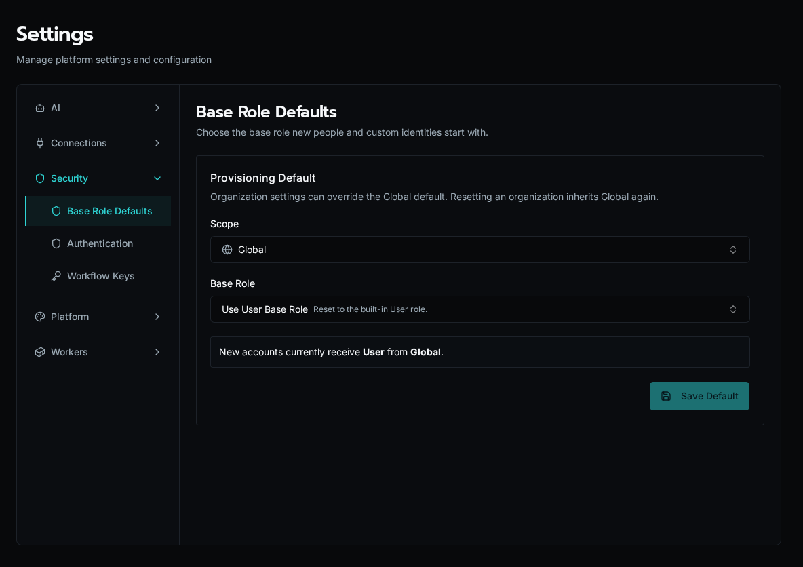

## Choose a Provisioning Default

1. Open **Settings → Base Role Defaults**.
2. Choose **Global** or an organization in **Scope**.
3. Choose the **Base Role** new people and custom identities should receive. The page shows the currently effective role and where it comes from.
4. Choose **Save Default**. The new default applies when accounts are provisioned; it does not rewrite existing role assignments.

An organization's override takes precedence over Global. Choose **Inherit Global Default** to remove that override. At Global scope, **Use User Base Role** resets the default to the built-in User role.

Existing people can receive a different base role or additional roles through their role assignments. Organization access and role permissions still determine their reach. Chat also requires its own permission; assigning access to an agent does not by itself grant access to Chat.
