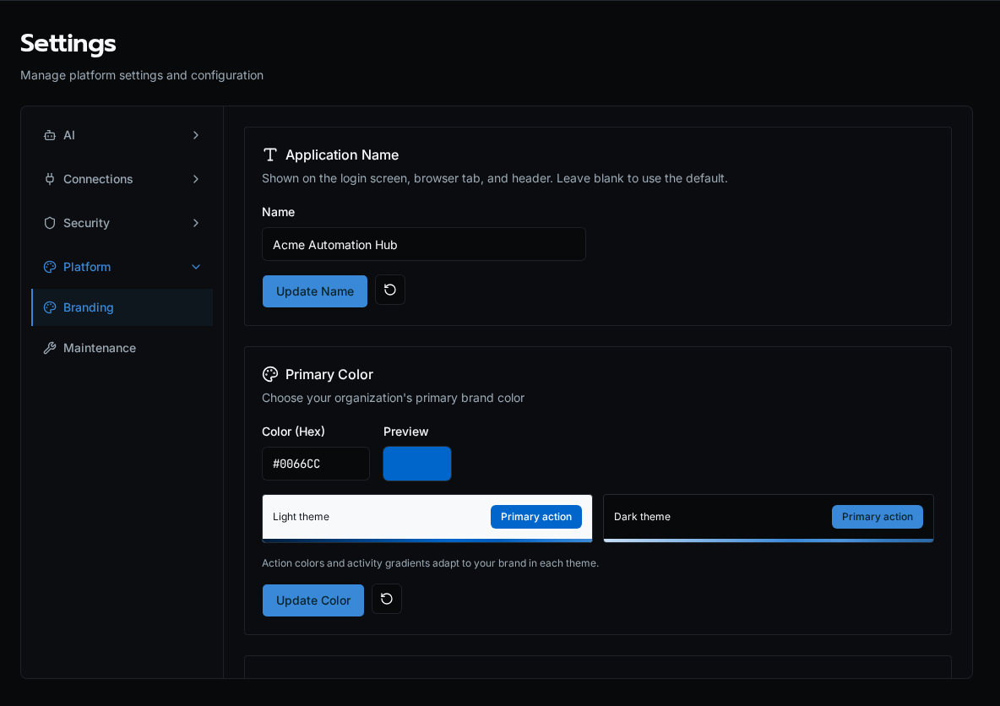

import { Aside } from '@astrojs/starlight/components';

The **Branding** tab lets you white-label the platform: an application name, a primary brand color, square and rectangle logos, and custom names for the three fixed product nouns (**Apps**, **Agents**, **Forms**). Branding is **global** — it applies to every organization on the instance, not per-org.

<Aside type="caution">
Branding is **platform-admin only**. The public read endpoint serves the same global settings to every user so the login screen and chrome are branded before sign-in.
</Aside>

## Open the page

Go to **Settings → Branding**, or directly to `/settings/branding`.

## Application name

Set the product name shown across the UI — the browser tab title, the login screen, and the header. Enter a name and click **Update Name**; leave it blank to fall back to the default "Bifrost." Like the rest of branding, the name is served to unauthenticated users too, so the login page reflects it before sign-in.

## Primary color

Enter a hex value (e.g. `#0066CC`) and click **Update Color**. The swatch previews the color, and on save it's converted to OKLCH and applied to every `primary` surface — buttons, links, sidebar accents — instantly, including a lightened dark-mode variant. Click the **reset** (↺) button to return to the platform default.

## Product terminology

Rename the fixed platform nouns before the UI renders. Each noun takes a **singular** and **plural** label:

| Noun | Default | Example override |
|---|---|---|
| Apps / Applications | App / Apps | Game / Games |
| Agents | Agent / Agents | Character / Characters |
| Forms | Form / Forms | Request / Requests |

Edit the cells and click **Update Terminology**. The new labels propagate through navigation, page titles, and buttons. Blank fields fall back to the platform default — you can't clear a label to empty.

<Aside>
Terminology overrides only relabel these three nouns in the UI. They do not rename API routes, CLI commands, or manifest keys — `bifrost apps`, `/api/agents`, and `forms.yaml` keep their canonical names.
</Aside>

## Logos

Upload a **square logo** (1:1, used for the sidebar icon and favicon-style spots) and a **rectangle logo** (16:9, used in the header). Drag a file onto the drop zone or click to browse.

- Accepted formats: PNG, JPG, SVG
- Max size: 5 MB
- Click the **reset** (↺) button on an uploaded logo to revert to the default mark

Logos are stored globally and preloaded on app boot so the branded chrome paints without a flash of the default logo.

## See also

- [Audit Log](/docs/how-to-guides/operations/audit-log/) — branding changes are control-plane mutations
- [Permissions](/docs/core-concepts/permissions/) — what gates the platform-admin-only Settings tabs
