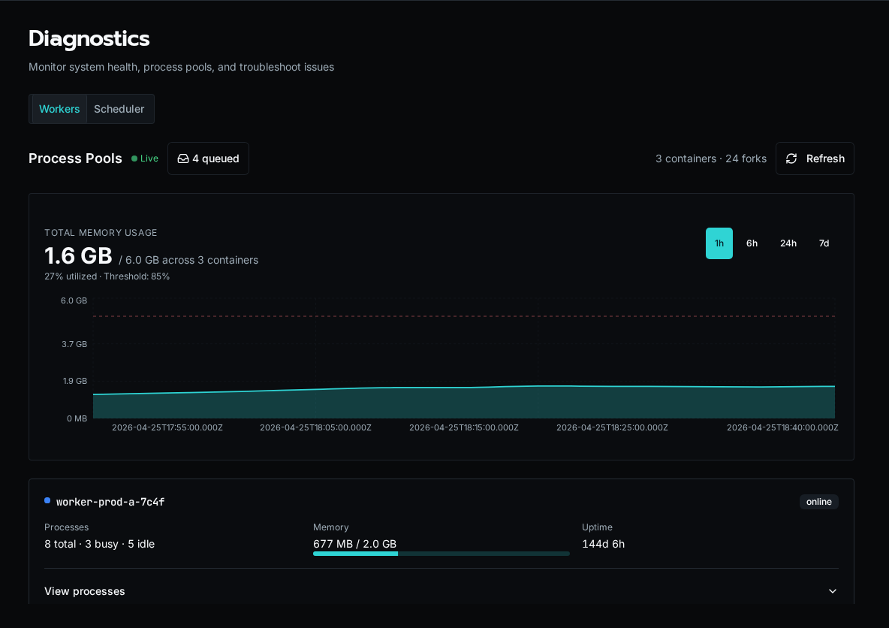
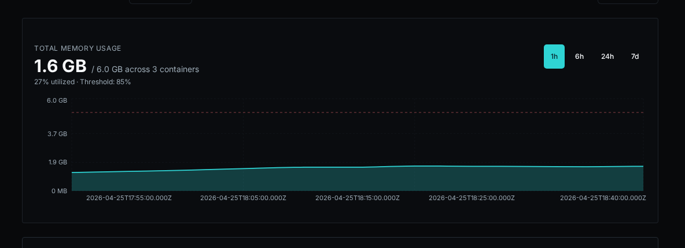
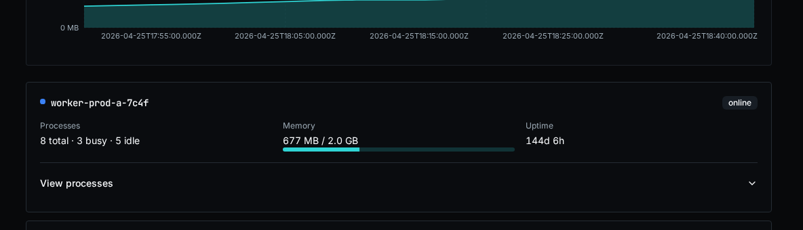
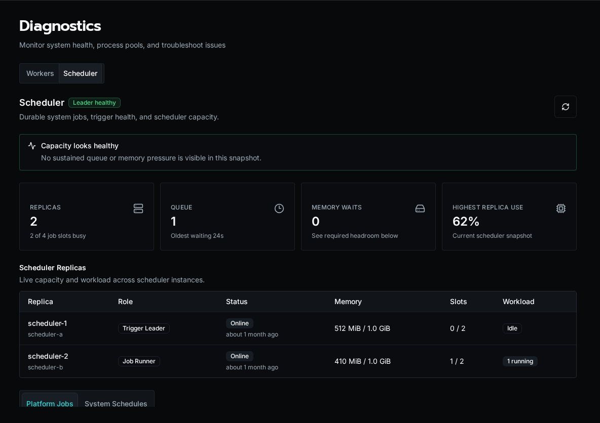

import { Aside } from '@astrojs/starlight/components';

The **Diagnostics** dashboard is the operator-facing view into Bifrost's worker containers, fork-based process pools, scheduler replicas (the API and its workers), platform-job capacity, queue depth, and live memory usage. It's the first place to look when executions or scheduled platform tasks are slow, queueing up, or crashing.

<Aside type="caution">
Diagnostics is **platform-admin only**. Org users don't see the page at all.
</Aside>

## Audience

This guide is for self-hosted operators and on-call engineers who need to:

- Confirm worker containers are connected and healthy
- Spot a hot fork that's chewing memory before it OOM-kills
- Triage backlog when the queue depth alert fires
- Trace which worker ran a specific execution

If you're a workflow author looking at a single failed run, use the **Execution History** page instead.

## Open the dashboard

Open **Diagnostics** from the sidebar, or go directly to `/diagnostics`.

The page has two tabs: **Workers** and **Scheduler**. The Workers header shows a **Live** indicator when the WebSocket worker stream is connected — if it says "Connecting…" instead, REST snapshots will still populate the page but you won't get sub-second updates.

## What it shows

### Summary header

The right-hand summary reports `N container(s) · M fork(s)`:

- **Container** — one Bifrost worker pod / container. Each container registers itself on startup over Redis.
- **Fork** — one OS-level process inside a container, started for a single execution and gone when it finishes. The fork count is the number of executions running right now.

Workers take work by memory, not by a fixed number of slots, so the fork count rises and falls with the work that fits. The container count should match the workers you run: on Docker Compose, the `worker` replicas (two by default); on Kubernetes, the worker Jobs the API has started, at least the **Warm Workers** setting. Fewer means a worker has died or hasn't registered yet — check its logs.

### Queue badge

The badge next to the **Live** indicator shows the executions waiting for a worker with room. A small backlog (single digits) is normal during bursts. Sustained double-digit backlogs mean your workers don't have enough memory for the incoming rate — add workers, give them more memory, or look for a slow workflow.

### Memory chart

A live time-series of total RSS per container, color-coded per worker. The chart retains the last few minutes of data and updates as WebSocket heartbeats arrive.

**Numbers worth alerting on:**

- **Sustained climb on a single container** while others are flat — usually a workflow leaking memory in a fork. Expand that container's card to see which fork is holding the bag.
- **All containers near their pod memory limit** — you're undersized for the workload. Add workers or raise their memory limit (see [Scaling workers](#scaling-workers)).
- **Sawtooth pattern** — each fork exits when its execution finishes and its memory is reclaimed (good). Steep teeth mean a single workflow is grabbing a lot of RSS per run; consider chunking it or tightening its data handling.

### Container cards

Each container has a card with its process count, aggregate memory, uptime, and health. Select **View processes** to inspect its forks. Per fork you see:

| Column | Meaning |
|---|---|
| **PID** | OS process ID inside the container. |
| **State** | `busy` while it runs its execution, or `killed` while it is being stopped. A fork stuck in `busy` for a long time is the most common smell. |
| **Memory (RSS)** | Resident set size in MB. Compare to the container's pod memory limit. |
| **Current execution** | Execution ID being processed, if any. Click through to the execution detail page. |
| **Uptime** | How long this fork has been running its execution. |

A fork that's been `busy` for longer than your `WORKFLOW_TIMEOUT` is wedged — either the workflow is in a tight loop or `asyncio` is blocked on a sync call. Kill the pod and inspect the worker logs.

## Refreshing the data

Two paths:

- **REST snapshot** — the page mounts with a one-shot `/api/platform/workers` call so the cards are populated immediately even if the WebSocket hasn't connected yet.
- **WebSocket heartbeats** — each container streams its state every few seconds; the cards merge in updates by `worker_id`. The **Live** dot pulses green while connected.

Click the **Refresh** button in the top-right to force a REST snapshot if you suspect the live stream is stale.

## Scheduler diagnostics

Open the **Scheduler** tab to see the elected leader, online replicas, active platform-job claims, runs and queued work waiting for room, tasks waiting for memory, and the highest replica memory utilization.

There is no separate scheduler service: the API replicas run schedules and triggers, and the workers run the jobs. The **Scheduler Replicas** table shows each one with its role:

| Role | Meaning |
|---|---|
| **Trigger Leader** | The API replica holding the trigger lease. It fires recurring schedules; if it is lost, another API replica takes over. |
| **Control** | Another API replica. It reconciles queued work and takes over the trigger lease if the leader is lost. |
| **Job Runner** | A worker. It claims workflow runs, agent runs and platform jobs. |

The **System Schedules** view shows each recurring task's cadence, execution mode, next run, last result, and memory change. Select a task row to inspect recent runs and diagnostic logs.

Use the recommendations at the top of the tab as scaling signals:

- Add workers or worker memory when runs keep waiting for a worker with room.
- Add memory when jobs keep waiting for memory admission or utilization approaches the configured limit.
- Investigate the trigger leader when tasks stop advancing even though replicas are online.

## Scaling workers

- **Docker Compose:** raise the `worker` replicas (`docker compose up -d --scale worker=3`) or the worker's memory limit in `docker-compose.yml`. The default is two workers with 2 GB each.
- **Kubernetes:** the API starts worker Jobs as work arrives. Change **Max Workers**, **Worker Memory** and the other limits in **Settings → Kubernetes → Scaling & Isolation**; changes apply without a restart.

See [Installation](/docs/getting-started/installation/#scaling-workers) for the recommended sizes.

## Common ops scenarios

**"Queue depth is climbing and won't drain."**
Expand the container cards and look for forks stuck `busy`. If containers have few forks and plenty of free memory, your bottleneck isn't workers — check the **Scheduler** tab and the API logs. If most forks are busy with the same workflow path, that workflow is the choke point.

**"A pod just OOM-killed."**
Pull the memory chart — you'll see the climbing line right up to the kill. Cross-reference the fork that was busy at that timestamp with the **Current execution** column to identify the workflow. File a ticket against that workflow author with the execution ID.

**"WebSocket says connecting forever."**
The browser tab is talking to the API; the API is talking to Redis to gather worker heartbeats. If the dot never goes green, check `redis-cli ping` from the API pod, then restart the pod.

## What it doesn't show

The diagnostics surface covers execution workers and the platform scheduler. It does **not** show:

- API request rates (use your reverse-proxy / APM)
- Database / Redis / S3 health (those are infrastructure dashboards)
- Per-workflow latency or token spend (use [Usage Reports](/docs/how-to-guides/operations/usage-reports/))

## See also

- [Audit Log](/docs/how-to-guides/operations/audit-log/) — who did what
- [Usage Reports](/docs/how-to-guides/operations/usage-reports/) — AI cost, CPU, peak memory
- [Versions and Compatibility](/docs/about/versioning/) — pinning workers to a known-good build
