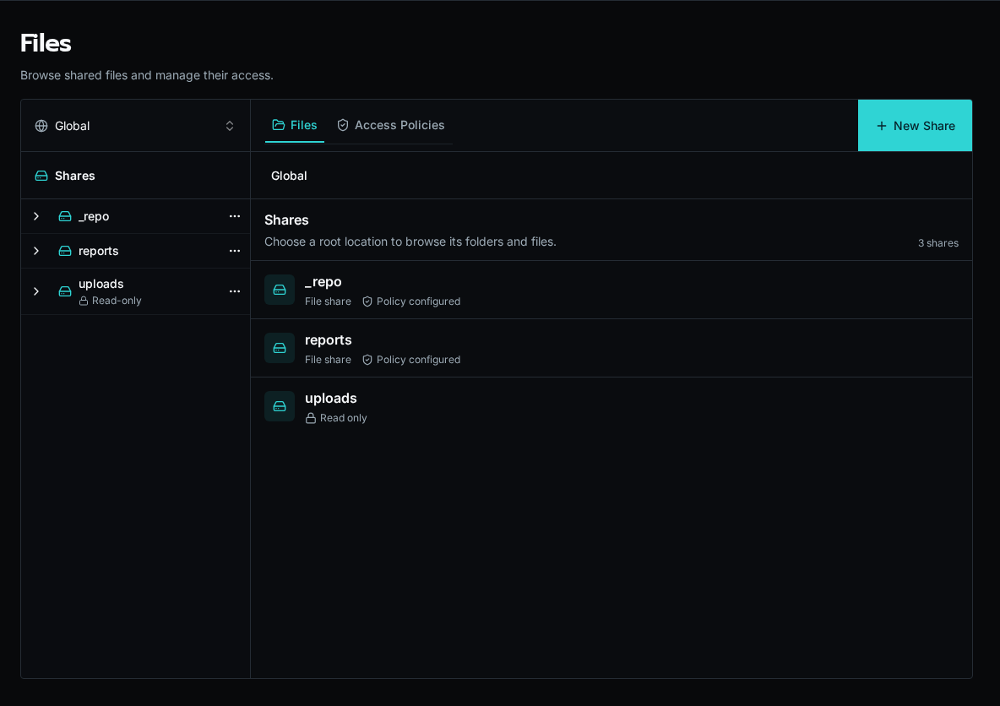

import { Aside, Steps } from '@astrojs/starlight/components';

The **Files** page gives platform administrators one place to browse storage locations, manage path-based policies, and verify what a user can do before a workflow or app touches a file.



## Browse a file scope

<Steps>

1. Open **Files** from the sidebar.

2. Choose **Global** or an organization from the scope selector.

3. Select a share, then open folders from the center pane.

4. Select a file to preview it and inspect effective access in the right pane.

</Steps>

Use **New Share** to create a writable storage location. The **Upload** action appears after you select a writable share or folder. The built-in `uploads` location is read-only from this surface.

## Manage path policies

Open the **Policies** tab to review every policy in the selected scope. A policy grants one or more actions—`read`, `write`, `delete`, or `list`—when its rules match. Policies can target a whole share, a folder prefix, or one file.

When several policies match a path, Bifrost evaluates the most specific path first. Use the effective-access panel on a selected file or folder to see the resolved cascade before editing it.

### Grant dynamic path scopes with a claim

When users have many changing folder grants, store one `user_id` and one `path_prefix` per row in a grant table. Define `allowed_resource_paths` as a list claim over the caller's rows, then use one policy at the location root:

```yaml
policies:
  - name: read_granted_resources
    actions: [read]
    when:
      path_within_any:
        - { file: path }
        - { claims: allowed_resource_paths }
```

`path_within_any` is available only in file policies. It matches the exact scope or a slash-delimited descendant, so `sites/123` does not match `sites/123-annex`. Missing, malformed, and empty/root claim values deny access.

Use immutable UUID path segments, such as `documents/sites/<site UUID>/categories/<category UUID>/pdf/<document UUID>/file.pdf`. Put view and source-download representations under separate segments when those permissions differ. Renaming a display label then leaves grants and stored paths unchanged.

Permission to a descendant does not imply permission to list every ancestor. Use an authorization-filtered table to build navigation, then authorize the selected file when it is opened.

## Test access

Choose **Test Access** from a file, folder, or policy action. Select a user and action, then run the test. The result identifies whether access is allowed and which policy or rule decided it.

<Aside type="note">
Files opened from a Solution install are pinned to that install's scope and are read-only. Change Solution-owned files through the Solution lifecycle instead of bypassing its ownership from the explorer.
</Aside>
