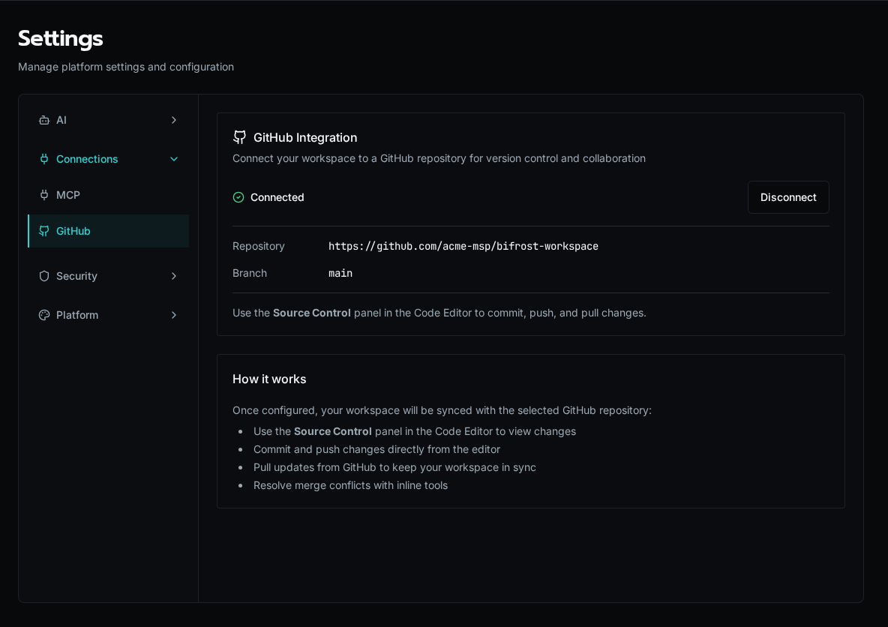

import { Aside, Steps } from '@astrojs/starlight/components';

The **GitHub** settings tab connects your Bifrost workspace to a GitHub repository. Once connected, the source code for your workflows and apps lives in version control, and you commit, push, and pull changes from the **Source Control** panel in the Code Editor.

<Aside type="note">
GitHub sync tracks workspace **code** — `workflows/*.py` and `apps/`. Platform entities created through the CLI, MCP, or UI (forms, agents, tables, configs) are managed separately; see [Exporting & Importing](../../portability/exporting-importing/) for moving those between environments.
</Aside>

## Open the settings tab

Navigate to **Settings → GitHub**, or go directly to `/settings/github`.

When a workspace is already connected, the tab shows the linked repository and branch. Use the **Source Control** panel in the Code Editor to commit and push from here on — you don't reconfigure for day-to-day work.

## Connect a repository

<Steps>

1. **Create a token.** On [github.com/settings/tokens](https://github.com/settings/tokens), create a personal access token with the `repo` scope.

2. **Validate the token.** Paste it into **GitHub Personal Access Token** and click **Validate**. Bifrost lists the repositories the token can reach. If the token matches a known repository, that repo is auto-detected.

3. **Pick a repository and branch.** Select an existing repository, or click **Create New** to create one in your account. Then choose the branch to sync with (defaults to `main`).

4. **Configure.** Click **Configure GitHub**. Setup runs as a background job — watch for a notification when it completes.

</Steps>

<Aside type="caution">
Configuring **replaces the workspace with the remote**. If you have uncommitted local code, commit it first or it will be overwritten by the repository contents.
</Aside>

## Day-to-day sync

Once connected, all git operations happen in the Code Editor's **Source Control** panel:

- **Commit and push** local changes to the remote branch.
- **Pull** updates from GitHub to keep the workspace in sync.
- **Resolve merge conflicts** with the inline conflict tools.

## Disconnect

To remove the integration, click **Disconnect** on the connected card and confirm. This deletes the stored token and repository configuration; the workspace files stay in place. You'll need to validate a token again to reconnect.
