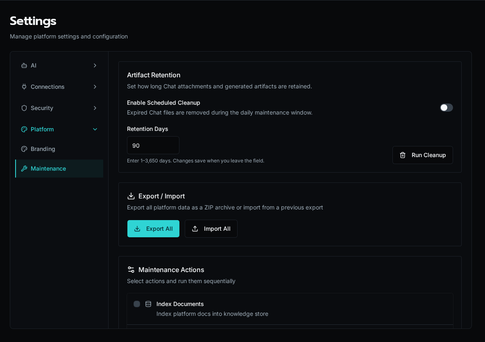

import { Aside } from '@astrojs/starlight/components';

The **Maintenance** tab is the operator toolbox for keeping a workspace's derived state in sync with its source of truth. It rebuilds things Bifrost normally maintains automatically — the documentation knowledge index, the app dependency graph, and the entity records imported from your repository — for the times when something drifts.

<Aside type="caution">
Maintenance is **platform-admin only** and acts on the whole workspace, not a single org.
</Aside>

## Open the tab

Navigate to **Settings → Maintenance**, or go directly to `/settings/maintenance`.

The tab has three sections: **Export / Import** at the top, the **Maintenance Actions** checklist, and a **Scan Results** panel that fills in after a run.

## Run a maintenance action

The actions checklist lets you select one or more tasks and run them in sequence. Tick the boxes, then click **Run Selected** — Bifrost runs them in a fixed order (index docs → rebuild dependencies → reimport) and shows a spinner per row, then a green check when each finishes.

### Index Documents

Indexes the platform documentation into the knowledge store so the chat assistant and agents can retrieve it. The result panel reports how many files were **indexed** (new or changed), left **unchanged**, **deleted**, and the total **duration**. Indexing is incremental — unchanged files are skipped, so re-running is cheap. If nothing changed since the last run, the action reports *skipped*.

### Rebuild App Dependencies

Re-scans every app's source for the workflows it calls and rebuilds the dependency graph that powers install-time validation and the "broken reference" warnings. The result panel summarizes apps scanned, files scanned, and dependencies rebuilt.

If an app references a workflow that no longer exists, it shows up under **Missing workflow references**, grouped by app, with the exact file and the missing `workflow:<id>` reference:

- Each broken reference means an app calls a workflow path that isn't present in the workspace — usually a renamed or deleted workflow.
- Fix it by restoring the workflow, or by updating the app's call to the new path, then re-run the scan to confirm it's clean.

A scan that finds issues also raises a workspace notification so the drift is visible outside this page.

### Reimport from Repository

Re-reads the entire workspace from S3 and reimports all entities — workflows, forms, agents, and apps. Use this after a manual repository edit, a restore, or when the in-database state has drifted from the committed source. The reimport runs as a background job; the page polls it and reports completion (or failure) via a toast. Large workspaces can take a minute or two.

<Aside type="caution">
Reimport overwrites database entity records from the repository. Run it when the repository is the authority you want to win — not to preserve unsynced UI edits.
</Aside>

## Export and import everything

The **Export / Import** card at the top is a workspace-wide escape hatch:

- **Export All** downloads a ZIP archive of all platform data.
- **Import All** opens a dialog to restore from a previous export.

This is the bulk counterpart to the per-entity export/import flows. For the portable, scrubbed solution format (and encrypted backups), use the [solution export/backup](/docs/how-to-guides/solutions/exporting-backup/) flow instead.

## When to reach for each tool

| Symptom | Action |
|---|---|
| Chat / agents can't find docs they should know | **Index Documents** |
| App shows a broken-workflow warning, or you renamed a workflow | **Rebuild App Dependencies** |
| DB entities don't match the committed repository | **Reimport from Repository** |
| Migrating a whole workspace or taking a full snapshot | **Export All** / **Import All** |

## See also

- [Diagnostics & Process Pools](/docs/how-to-guides/operations/diagnostics/) — worker health and queue depth
- [Knowledge Bases](/docs/how-to-guides/ai/knowledge-bases/) — what the documentation index feeds
- [Export & Backup a Solution](/docs/how-to-guides/solutions/exporting-backup/) — portable, scrubbed exports
