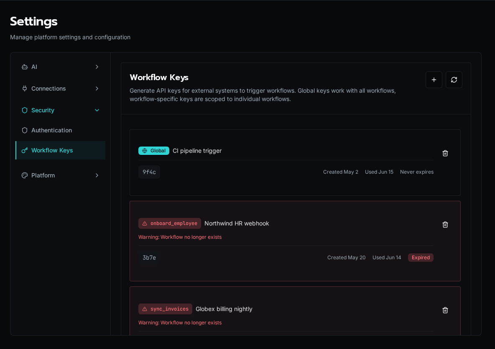

import { Aside } from '@astrojs/starlight/components';

**Workflow Keys** are API keys that external systems use to trigger Bifrost workflows over HTTP, without a user session. A CI pipeline, a CRM webhook, or a billing job presents the key in a request header and the workflow runs. Each key is either **global** (can execute any endpoint-enabled workflow) or **workflow-specific** (scoped to one workflow).

<Aside type="caution">
The raw key is shown **only once**, at creation. Copy it immediately — Bifrost stores only a hash plus the last four characters for display, so it cannot be retrieved later. If you lose it, revoke and create a new one.
</Aside>

## Open the page

Navigate to **Settings → Workflow Keys**, or go directly to `/settings/workflow-keys`.



Each card shows the key's **scope** (a `Global` badge or the workflow name), its description, the masked key (last four characters), when it was created and last used, and its expiration.

## Create a key

Click the **+** button in the top right. In the dialog:

- **Description** (required, max 32 chars) — a label so you can tell keys apart later, e.g. `CI pipeline trigger`.
- **Global Key** — check this to let the key execute *any* endpoint-enabled workflow. Leave unchecked to scope it to one workflow.
- **Workflow** (required when not global) — the workflow this key may trigger. Only **endpoint-enabled, non-public** workflows that don't already have a key appear in the list.
- **Expiration** — `Never`, or 30 / 60 / 90 / 180 / 365 days. Defaults to 90 days.

On submit, the key is shown once with a ready-to-paste `curl` example. Copy it before closing the dialog.

<Aside>
Only workflows with their HTTP endpoint **enabled** can be triggered by a key. Enable the endpoint on the workflow itself (Workflows → the workflow → endpoint settings) before creating a scoped key for it. Workflows marked **public** skip authentication entirely and don't use keys.
</Aside>

## Trigger a workflow

Present the key in the `X-Bifrost-Key` header and POST your input to the workflow's endpoint:

```bash
curl -X POST "$BIFROST_URL/api/endpoints/<workflowId>" \
  -H "X-Bifrost-Key: bk_live_xxxxxxxx" \
  -H "Content-Type: application/json" \
  -d '{"input": "your data"}'
```

A global key works against any endpoint-enabled workflow ID. A workflow-specific key only works against the workflow it was scoped to — any other ID returns `403`.

## Revoke a key

Click the trash icon on a key's card and confirm. Revocation is **immediate and irreversible**: any system using that key starts getting rejected on the next request. Revoke promptly when a key leaks or a downstream integration is retired.

## Orphaned and expired keys

A key whose target workflow no longer exists is flagged as **orphaned** (red border, warning badge) and sorts to the bottom — its workflow was renamed or deleted out from under it. **Expired** keys carry an `Expired` badge. Both still occupy a slot but can no longer execute; revoke them to clean up.

## Disable global keys for a workflow

A sensitive workflow can opt out of global keys entirely, so only a workflow-specific key can reach it. This is the `disable_global_key` flag on the workflow itself — set it on the workflow when you want to force per-workflow key issuance for that endpoint.

## See also

- [Audit Log](/docs/how-to-guides/operations/audit-log/) — key creation and revocation are recorded as control-plane events.
- [Permissions](/docs/core-concepts/permissions/) — what a triggered workflow can do once it runs.
