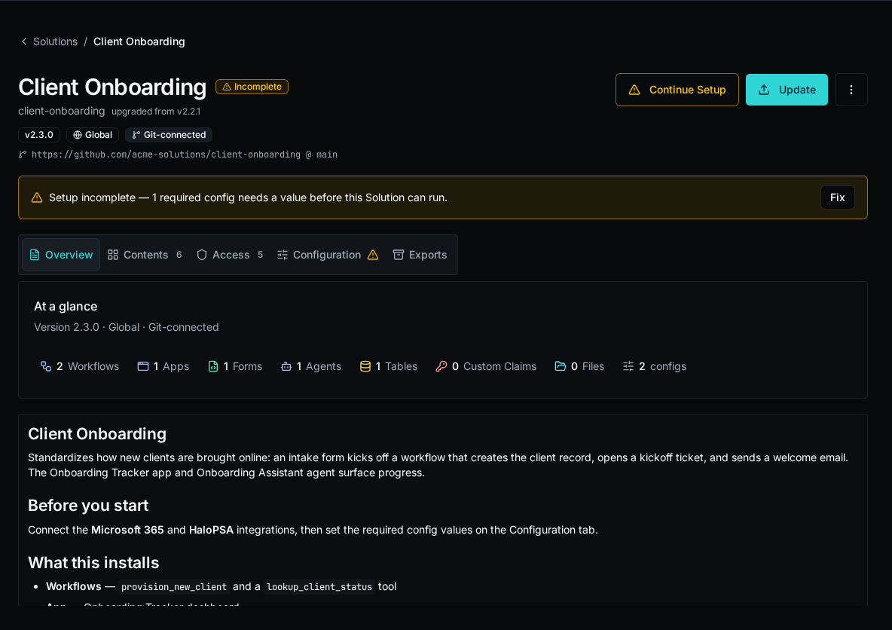

import { Steps, Aside } from "@astrojs/starlight/components";

A Solution update is a full replace: applying a newer version overwrites the install's managed entities with the bundle's. How you apply it depends on whether the install is git-connected.

## See whether an update is available

For a git-connected install, Bifrost compares the installed version against the `version:` field of `bifrost.solution.yaml` at the connected ref's HEAD (PEP-440 ordering, **not** git tags). When the remote descriptor version is a clean increment over the installed one, the catalog badges the install and emits a `solution.update_available` event. The sweep runs every 6 hours.



<Aside type="note">
An author signals a new version by bumping `version:` in the descriptor and pushing — no git tag or release ceremony is needed. This is what lets one omni-repo version N Solutions independently by subfolder.
</Aside>

## Update a git-connected install (auto-pull)

A git-connected install is written **only** by auto-pull — `bifrost solution deploy` is refused for it (`409`). Trigger a pull to apply the repo's current HEAD:

<Steps>

1. From the Solutions catalog, sync the install to pull the latest commit. (This is the same writer a webhook or the scheduled poll uses.)

2. Bifrost clones the repo at the connected ref, full-replaces the install's managed entities, and clears the update-available badge.

</Steps>


## Update from a workspace (redeploy)

For an install that is **not** git-connected, ship a newer version by redeploying the authoring workspace.

<Steps>

1. Bump `version:` in `bifrost.solution.yaml`.

2. From the solution root, deploy. The command resolves the matching install and full-replaces it:

    ```bash
    bifrost solution deploy
    ```

   Use `--org <id|name>` or `--global` to target an install in another scope, and `--solution <install-id>` if more than one install matches.

</Steps>

If the bundle version is older than the installed version, deploy `409`-blocks. Apply the downgrade deliberately with `--force`:

```bash
bifrost solution deploy --force
```

## Update one managed entity

There is no live edit of a managed entity — saving one in the UI returns a `409`. To change a single form, agent, table, or config, edit it in source and redeploy the whole bundle.

<Steps>

1. Edit the entity's field in the workspace `.bifrost/*.yaml` manifest (for example, a form's fields in `.bifrost/forms.yaml`, or an agent's prompt in `.bifrost/agents.yaml`).

2. Redeploy:

    ```bash
    bifrost solution deploy
    ```

</Steps>

Because deploy is a full replace, only the entities present in your manifest survive. Editing one entry and redeploying changes that entity and leaves the rest intact — but an entity dropped from the manifest is deleted from the install.

<Aside type="caution">
If you captured loose entities into the install since your last deploy (`bifrost solution capture`), run `bifrost solution pull` before this redeploy. Otherwise the full replace would delete the captured-but-unpulled entities, and deploy `409`-blocks to stop it. See [Deploy a Solution from a Workspace](/docs/how-to-guides/solutions/deploying/).
</Aside>
