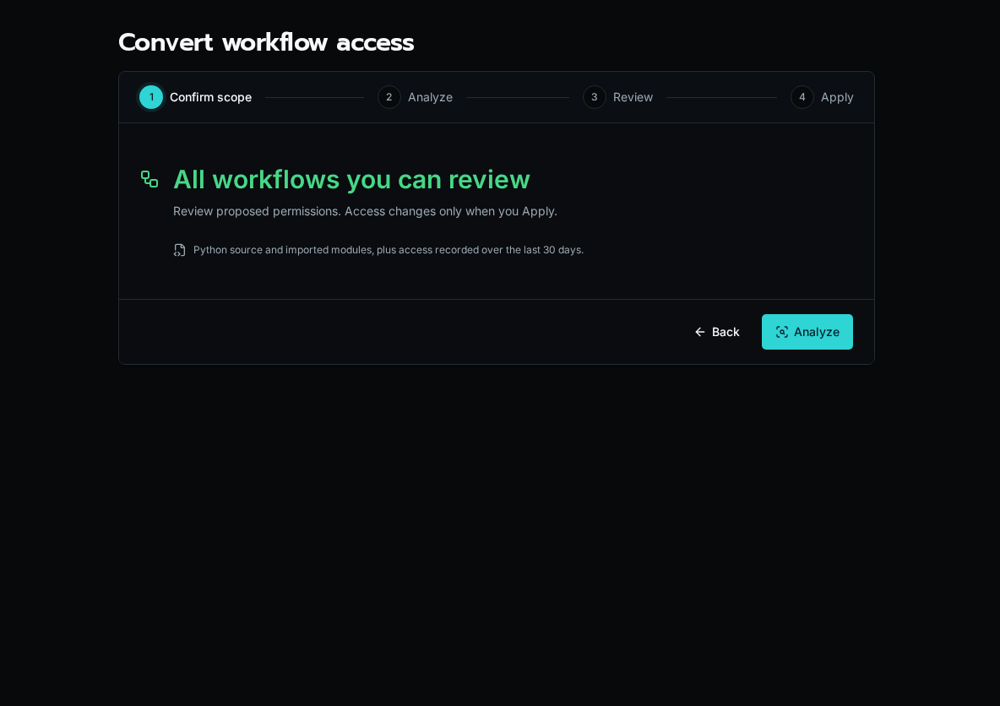

## Review and Apply a Conversion

1. Open **Workflows**, select the workflows to review, and choose the conversion action. The conversion page at `/workflows/convert` can also analyze all workflows you can review.
2. Choose **Analyze**. Analysis considers Python source, imported modules, and access recorded over the last 30 days. It does not run your workflows or change access.
3. Open each workflow's review. Check suggested permissions, uncertainties, and any Solution declarations. Suggestions can miss dynamic behavior or grant more than necessary.
4. Select the reviewed workflows and choose **Review Selected**, then **Apply Reviewed Changes**. Their current run identities and organization reach are preserved.
5. Test important workflows, including their normal integrations and organization scopes. Resolve missing or excessive permissions before converting the remaining workflows.

Changing the platform default to **Declared Permissions** is a separate cutover. Review the remaining Full Access workflows and the readiness checks before confirming it. A conversion report alone does not prove a workflow's business behavior.
