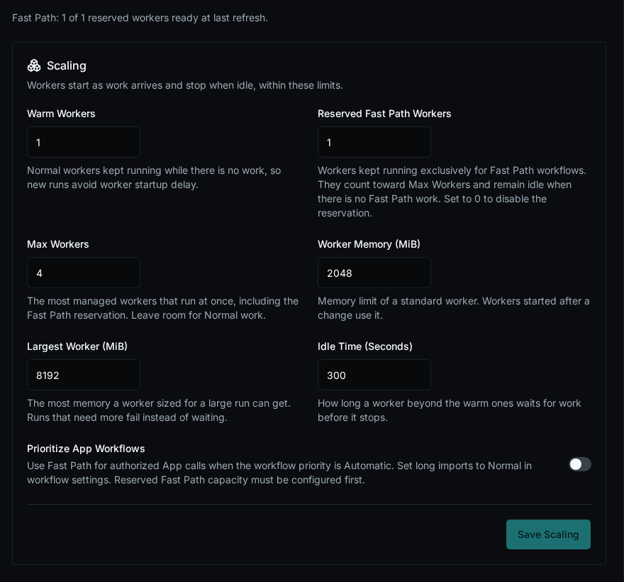
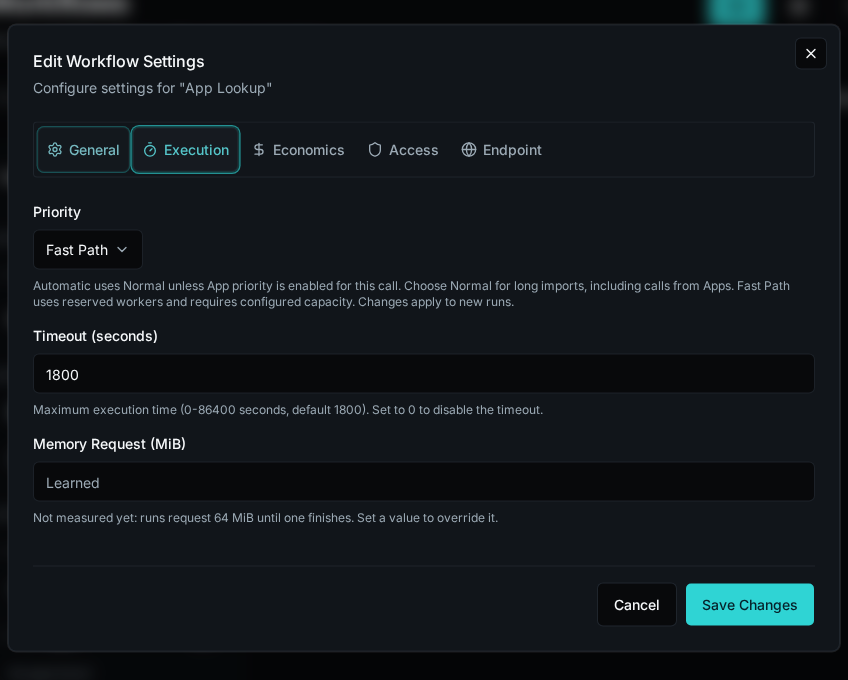

## Reserve Capacity

Sign in as a platform administrator. Open **Settings → Workers → Scaling & Isolation**.

For Kubernetes-managed workers:

1. Set **Reserved Fast Path Workers** to the number of workers to dedicate to priority workflows.
2. Keep **Max Workers** large enough for the reservation plus **Warm Workers**, with at least one slot available for Normal work. For example, use one warm Normal worker, one reserved Fast Path worker, and a maximum of two workers.
3. Select **Save Scaling**. Check the ready-worker count above the Scaling card; requested capacity may still be starting or being replaced. Reload the page to refresh that snapshot.



For a fixed worker, set this variable on the worker container and recreate that container:

```yaml
environment:
  BIFROST_POOL_WORKER_EXECUTION_LANE: fast_path
```

Keep separate Normal workers for background workflows, agents, services, summaries, and platform jobs. The Kubernetes reservation count controls managed workers; fixed workers are budgeted separately. External capacity providers do not support Fast Path in this version.

## Select Workflow Priority

1. Open **Workflows**, open the workflow's action menu, and select **Edit**.
2. Select **Execution → Priority** and choose **Fast Path**.
3. Save the workflow settings. New runs use the dedicated workers; already accepted runs keep their original lane, including scheduled runs.



Configure dedicated capacity before submitting Fast Path work. A new Fast Path run is refused when neither a reservation nor a fixed Fast Path worker is configured. A run too large for a standard Fast Path worker is refused rather than sent to Normal capacity.

## Optionally Prioritize App Calls

On **Settings → Workers → Scaling & Isolation**, enable **Prioritize App Workflows**. The switch is off by default.

| Workflow Priority | Behavior |
| --- | --- |
| **Automatic** | Normal unless App promotion is enabled and the server authorizes the App context for the call. |
| **Normal** | Always Normal, including calls from Apps. Use this for lengthy imports. |
| **Fast Path** | Always uses dedicated Fast Path capacity. |

An App can start lengthy work, so App promotion does not establish that a run is short or that a human clicked a button. Select **Normal** explicitly for those workflows.

## Capacity and Limits

Normal work cannot borrow Fast Path workers, even while they are idle. Reserving workers therefore reduces the capacity available to Normal work or requires a larger total budget. Runtime package updates still reach both lanes.

A reservation protects worker availability from Normal backlog; it does not guarantee response time. Fast Path can fill with its own work, and shared CPU, database, or API bottlenecks can still cause delays. Set appropriate CPU and memory requests on the workers.

Reducing a Kubernetes reservation is allowed. Removing its last worker is refused while Fast Path runs are queued or scheduled unless a fixed Fast Path worker remains. Move workflows back to **Normal** for new runs before retiring their dedicated capacity.
